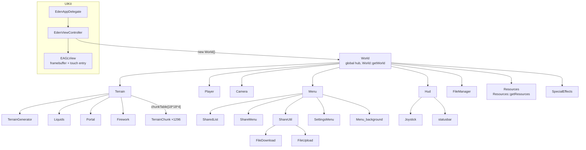
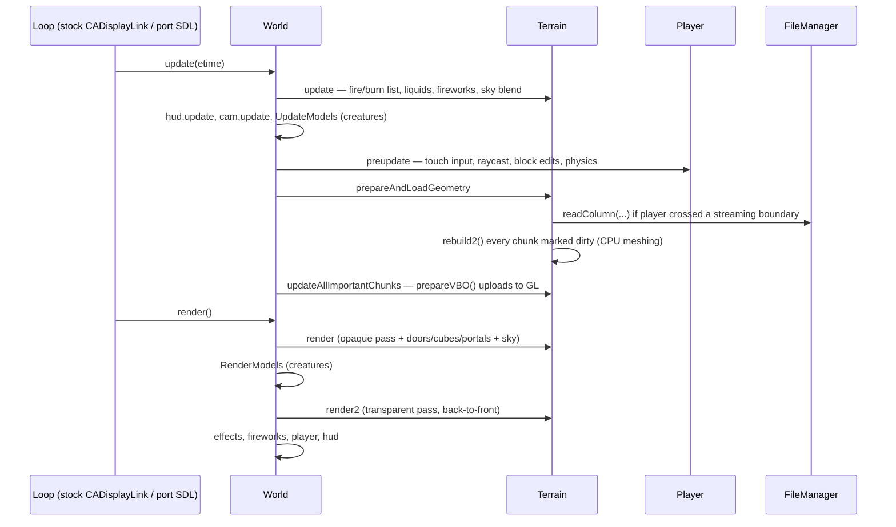

# Architecture Overview

Eden: World Builder is a voxel building game for iOS (2010–2014 era), written in
Objective-C++ against **OpenGL ES 1.1 (fixed-function)**. This repository is the 2.1.1
source release, ported as Emod to SDL3 + GL on macOS, Linux, Windows and iOS (`native/`, over the
seam/shim layer in `port/`; see `../CLAUDE.md`). The engine still issues ES 1.1 calls; the port's
translator (`port/src/shim/gl/`) runs them on ES3/GL. This file describes the engine; the stock iOS
shell in the diagrams below (UIKit, `EAGLView`, CADisplayLink) is replaced on every port target.

There is **no engine/game separation, no scene graph, and almost no abstraction layer**.
The game is a set of singletons wired together through raw pointers and `extern` globals.
Understanding the ownership graph below is 80% of understanding the codebase.

## Ownership graph

Stock graph. On the port the UIKit subgraph is `port/src/seam/*_native` (an SDL window and loop), and
the `ShareUtil`/`FileDownload`/`FileUpload`/`SharedList`/`ShareMenu` branch is replaced by
`WorldBrowser`/`WorldShare` over the `eden_net_*` seam ([networking.md](networking.md)). The chunk
table is `CHUNKS_PER_SIDE²·CHUNKS_PER_COLUMN` slots: 18×18×4 = 1296 at the default radius and 64z.

Everything reaches everything else through two static singletons:

- `World::getWorld` (a static **member pointer**, not a function — `World.h:56`)
- `Resources::getResources` (same pattern)

plus C-style globals for hot data: `blockarray` (block cache), `lightarray`,
`chunkTablec`, `g_offcx`/`g_offcz`, `colorTable[256]`, `blockinfo[]`, and the
`Input::getInput()` singleton.

## Major systems

| System | Files | One-line purpose |
|---|---|---|
| App shell / main loop | stock: `main.m`, `EdenAppDelegate`, `EdenViewController`, `EAGLView`; port: `port/src/harness/`, `port/src/seam/` | Frame loop, GL context, input entry (stock: CADisplayLink + UIKit touches; port: SDL) ([execution-flow.md](execution-flow.md)) |
| World hub | `World.cpp` | Game-mode state machine, per-frame update/render dispatch |
| Terrain | `Terrain.cpp`, `TerrainChunk.cpp` | Voxel storage, block edit ops, fire/TNT dynamics, chunk meshing, terrain rendering ([world-and-terrain.md](world-and-terrain.md), [rendering.md](rendering.md)) |
| Terrain generation | `TerrainGenerator.cpp`, `TerrainGen2.cpp`, `FileManagerHelper.cpp` | Flat-world runtime gen; offline generator for the shipped default world `Eden.eden` ([terrain-generation.md](terrain-generation.md)) |
| Save/load | `FileManager.cpp`, `EdenWorldStore`, `EdenWorldSource`, `EdenWorldExport`, `WorldTrailer` | `.emod` world files (the only played format), column streaming, `.eden` import/convert/export ([save-load.md](save-load.md), [emod-file-format.md](emod-file-format.md), [eden-file-format.md](eden-file-format.md)) |
| Player/physics | `Player.cpp`, `Camera.cpp`, `Input.cpp`, `Util.cpp` | Touch processing, SAT polyhedra collision, movement, block pick raycast ([player-input-camera.md](player-input-camera.md)) |
| Creatures | `Model.cpp` | Up to 300 animated creatures (`CreatureModel`, `.edm` converted from the `.pod` art), AI, save/restore ([entities-and-creatures.md](entities-and-creatures.md)) |
| Dynamics | `Liquids.cpp`, root `Lighting.cpp`, `Portal.cpp`, `Firework.cpp`, `Fire.cpp`, `BlockBreak.cpp`, `SpecialEffects.cpp` | Water/lava flow, colored point lights, portals, particles ([lighting-liquids-effects.md](lighting-liquids-effects.md)) |
| UI | `Hud.cpp`, `Menu.cpp`, `SharedList.mm`, `ShareMenu.mm`, `SettingsMenu.cpp`, `Joystick.cpp`, `statusbar.cpp`, `VKeyboard.mm`, `Alert.mm` | In-game HUD modes and the entire menu system, all custom GL rendering ([ui.md](ui.md)) |
| Networking | stock: `ShareUtil.mm`, `FileUpload.mm`, `FileDownload.mm`; port: `WorldBrowser.cpp`, `WorldShare.cpp` | World sharing over HTTP to edengame.net ([networking.md](networking.md)) |
| Added after the 2.1.1 import | `GLWidgets`, `GLDialog`, `KeybindsMenu`, `NewWorldMenu`, `MeshPool`, `Shadow`, `SignRenderer`, `SignTool`, `CmdScript`, `PassTimers.h`, `UIIcons.h`, `zstd/` (list: `port/tools/engine-sources.txt`) | The GL widget kit and screens, baked shadows, signs and command blocks, per-pass timers, the `.emod` codec ([ui.md](ui.md), [lighting-liquids-effects.md](lighting-liquids-effects.md), [eden-file-format.md](eden-file-format.md)) |
| Assets/audio | `Resources.cpp`, `Texture2D.mm`, CocosDenshion | Texture atlases, sounds, ambient audio ([resources-and-audio.md](resources-and-audio.md)) |
| Third-party | `CC*`/`CD*`, `glu*`, `zpipe`, `md5`, `Appirater`, Flurry | See [third-party.md](third-party.md) |

## Data flow, one frame (game mode)

## The three big architectural ideas

1. **A sliding toroidal window over an "infinite" world.**
   Only an 18×18-chunk-column area (288×288×64 blocks) around the player is resident.
   *(Port: the height and, since B.5b-2, the window radius are runtime — up to 32×32 columns.)*
   World coordinates are absolute (the default world centre is at chunk 4096, block
   ~65,536); resident storage (`blockarray`, `chunkTable`) is indexed **modulo** the
   window size, so walking simply overwrites the far edge of the arrays with newly
   streamed columns — no memmove ever happens. See [world-and-terrain.md](world-and-terrain.md).

2. **Append-only save files with a directory at the end.**
   A `.eden` file is `header | column data | creatures | directory`. New columns are
   appended where the creatures block sits, and creatures + directory are rewritten
   after them. Only the directory pointer in the header moves. See
   [eden-file-format.md](eden-file-format.md). *(Port: worlds are `.emod` since S.8, an append-only log
   of CRC'd zstd records where a save is one commit record; `.eden` is import/export only —
   [emod-file-format.md](emod-file-format.md).)*

3. **The shipped default world is itself a giant `.eden` file.**
   `TerrainGen2.cpp` is an *offline* generator (run via the `JUST_TERRAIN_GEN` build
   flag) that produced the 2880×2880-block `Eden.eden` bundled with the app. At
   runtime, "generation" for the default world is mostly *streaming decompression*
   from that bundle. See [terrain-generation.md](terrain-generation.md). *(Port: the shipped bundle is
   `Eden.emod`, baked from the repo-root `Eden.eden` by `port/tools/emod.py bake-default`.)*

## Engine vs. game code (summary)

Roughly 60% of the lines in `Classes/` were third-party or generic (the PowerVR SDK until LG.7,
CocosDenshion, Texture2D, a GLU port, hashmap, math/collision utilities). The
game-specific core is ~15k lines concentrated in Terrain/TerrainChunk/FileManager/
Player/Hud/Model/Menu. A concrete separation roadmap is in
[engine-vs-game.md](engine-vs-game.md).

## Tracing a block edit

Touch (port: an SDL mouse/finger event turned into a synthetic touch) → `Hud::update` (consumes UI
touches) → `Player::processInput` → `findWorldCoords` raycast → `Terrain::buildBlock`/`destroyBlock`/… →
`updateChunks` (dirty lists) → next frame `prepareAndLoadGeometry` (mesh, `rebuild2`) →
`updateAllImportantChunks` (VBO upload).

## Reading order for new contributors

1. This file, then [conventions-and-pitfalls.md](conventions-and-pitfalls.md) — **do not
   skip**; the `(x, z, y)` argument convention alone will otherwise cost you a day.
2. [world-and-terrain.md](world-and-terrain.md) — the data model.
3. [execution-flow.md](execution-flow.md) — how a frame runs.
4. [eden-file-format.md](eden-file-format.md) + [save-load.md](save-load.md).
5. Whatever subsystem you're touching.
