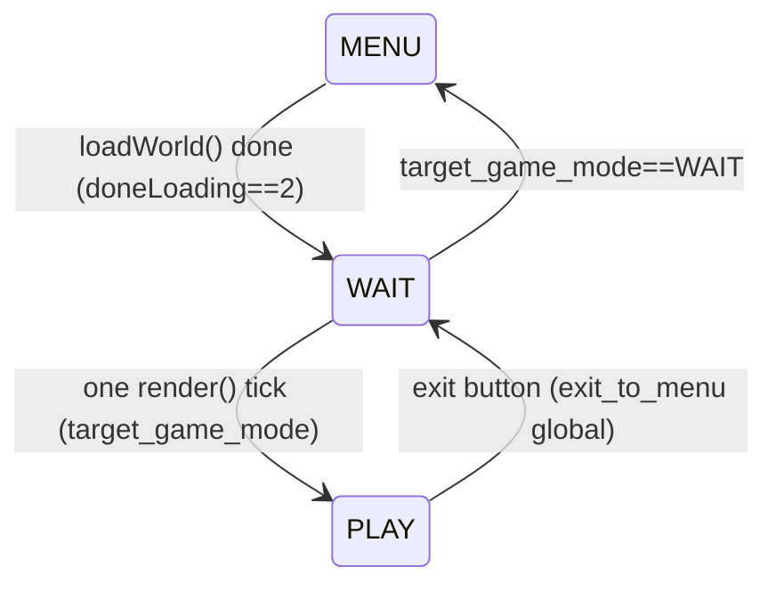

# Execution Flow, App Lifecycle & Threading

## Purpose
How the app boots, how a frame runs, the game-mode state machine, and which code runs
on which thread.

The live boot and loop are the native port's (next section). The stock iOS shell sections after it
(`main.m`, `EdenAppDelegate`, `EdenViewController`, `EAGLView`, CADisplayLink) describe the 2.1.1
app; those files are seam-excluded on every port target and kept as reference. `World` and
everything below it are shared.

## Native boot and loop (the port; `native/src/`)
- **Boot** (`main()` in `native/src/entry/eden_main_native.cpp`): parse `--*` options →
  `SDL_InitSubSystem(EVENTS)` → `SDL_AddEventWatch` (background/terminate save, below) →
  `eden_gl_context_create()` (window + GL context; must precede the engine, because
  `World::World()` issues real GL calls; a failure leaves the engine running headless) →
  `eden_seam_main()` (`native/src/seam/main_native.cpp`: publishes the screen-metric globals that
  `EAGLView` used to set, then `EdenAppDelegate::didFinishLaunching()` →
  `EdenViewController::construct()` (`new World()`) and `startAnimation()`) → input init → settings
  load → either a `--*` harness mode or the interactive loop. The default and saves directories
  come from `eden_platform_documents_root()` (`native/src/eden_app_identity.h`).
- **Interactive loop**: sleep to the Settings fps cap (`eden_get_fps_cap()`; 0 = uncapped,
  vsync-bound), then `pump_events()` (SDL events: quit, focus, resize, input) → `settings_pump()` →
  `eden_native_input_tick()` (queued input, *before* the engine tick that consumes it) →
  `EdenViewController::drawFrame(true)` → `eden_native_audio_tick()` → `eden_heap_pressure_tick()`.
- **`drawFrame`** (`native/src/seam/EdenViewController_native.cpp`): wall-clock `etime`, clamped to
  0.1 s (a harness may fix it), inside an autorelease pool → `world->update(etime)` →
  `world->renderFrame(draw)` (always called, even when not drawing — it owns the WAIT promotion and
  the exit check) → present. The `TRUE` "retina swap" answer of `World::update` is **ignored by
  design**: `IS_IPAD`/`SCALE_*` are the layout point space here, not the resolution.
- **Lifecycle**: `SDL_EVENT_QUIT` and (via the event watch) `SDL_EVENT_WILL_ENTER_BACKGROUND` /
  `SDL_EVENT_TERMINATING` call `EdenAppDelegate::onPageHide()` — save the open world
  (`eden_app_will_background()`, docs/save-load.md "Save-on-background"), then `stopAnimation()`.
  Focus loss only pauses the loop (`onVisibilityHidden`, no save); focus gain / foreground resume it.
- `LOW_MEM_DEVICE` and `LOW_GRAPHICS` are never set on native (a decision, commented above
  `eden_seam_main()` in `main()`), and `eden_low_memory()` stays 0.

## Important files (stock iOS shell)
- `main.m` — trivial `UIApplicationMain`.
- `Classes/EdenAppDelegate.mm` — sets root VC, starts Flurry + Appirater, forwards
  foreground/background to `startAnimation`/`stopAnimation`.
- `Classes/EdenViewController.mm` — owns the `EAGLContext` (ES 1.1), the CADisplayLink
  loop, device-capability detection, and the `World` instance.
- `Classes/EAGLView.mm` — CAEAGLLayer framebuffer management, screen-metric globals,
  touch forwarding to `Input`.
- `Classes/World.mm` — game-mode dispatch.

## Boot sequence (stock iOS)

1. `MainWindow.xib` instantiates `EdenAppDelegate`, `EdenViewController`, `EAGLView`.
2. `EAGLView initWithCoder:` (runs first) sets the global screen metrics:
   `IS_IPAD`, `IS_RETINA`, `SUPPORTS_RETINA`, `IS_WIDESCREEN`, `SCREEN_WIDTH/HEIGHT`,
   `SCALE_WIDTH/HEIGHT`, `P_ASPECT_RATIO`, and probes for an ES2 context purely to
   decide the far plane: `P_ZFAR=120` if ES2-capable hardware, else `20`
   (in `initWithCoder:`; on the port `eden_seam_create_eagl_view` sets the screen metrics and the far
   plane is set by `Graphics::setZFAR` per the view-distance setting). **Pitfall:** on a Retina iPhone, `IS_IPAD` is set to `TRUE` —
   the flag really means "2× logical scale", not "is an iPad".
3. `EdenViewController awakeFromNib`:
   - creates the ES1 context, sets `LOW_GRAPHICS` / `LOW_MEM_DEVICE` from
     `physicalMemory` thresholds (~480 MB / ~300 MB, in `awakeFromNib`).
   - `world = new World()`.
4. `World::World()`:
   - `new Resources()` (loads menu textures, audio engine),
   - `tc_initGeometry()` (fills the shared `allIndices` index buffer),
   - `new Terrain()` (which creates TerrainGenerator/Liquids/Portal/Firework —
     but **does not allocate the block arrays yet**),
   - `Graphics::initGraphics()`, `alert_init()`, `vkeyboard_init()`,
   - `new Camera/Player/Hud/FileManager/SpecialEffects/Menu`,
   - starts the menu music. Game starts in `GAME_MODE_MENU`.
   - `FileManager::FileManager()` also calls `fmh_init()` which opens the **bundled**
     default world — `Eden.emod` through `EdenWorldStore` since S.6 (stock: the RLE `Eden.eden`
     and its directory hashmap).
5. `viewWillAppear` → `startAnimation` → CADisplayLink at 60 Hz calling `drawFrame`.

There is a compile-time alternate mode: `#define JUST_TERRAIN_GEN 1` (`World.h`)
turns the app into the offline default-world generator (see
[terrain-generation.md](terrain-generation.md)).

## Frame loop (stock iOS)

`EdenViewController drawFrame` (stock; the port's twin is above):

```
etime = now - last            // wall-clock delta, float seconds
setFramebuffer
world->update(etime)          // returns TRUE => retina framebuffer swap requested
world->render()
presentFramebuffer            // discards depth attachment first
[optional] delete + recreate framebuffer at other scale ("retinaSwap")
```

The retinaSwap dance exists because the menu renders at Retina resolution but the
game world runs at 1× on Retina iPhones for fill-rate reasons; entering/leaving a
world flips the CAEAGLLayer `contentsScale` and the `IS_IPAD/IS_RETINA/SCALE_*`
globals (the tail of `drawFrame`, `World::update` GAME_MODE_WAIT branch,
`World::exitToMenu`). The port ignores the swap (above).

## Game-mode state machine

`World::game_mode` ∈ `GAME_MODE_MENU (0)`, `GAME_MODE_PLAY (1)`, `GAME_MODE_WAIT (2)`.



- `GAME_MODE_WAIT` is a one-frame buffer state: `World::render()` in WAIT does nothing
  but promote `target_game_mode` — this gives the framebuffer swap a clean frame.
- `exit_to_menu` is a file-static BOOL in `World.mm` set by the HUD menu; it is checked
  at the *end* of `World::render()` so teardown never happens mid-frame.
- **Modified from stock (2026-07-30):** those two transitions are the reason
  `render()` is now a one-line wrapper over `World::renderFrame(BOOL draw)`.
  `renderFrame(FALSE)` draws nothing but still runs the WAIT promotion and the
  `exit_to_menu` check, so a caller that wants to drop a frame's *drawing* (the native
  `drawFrame(false)`; first the web build's frame-rate cap) can do so without wedging a
  loading world in WAIT forever. `render()` itself is behaviourally unchanged.

### update() in PLAY mode (`World::update`)
Order matters and is load-bearing. Ahead of the steps, two port early-outs (modified from stock):
while a `GLDialog` is active only the dialog updates, and while the in-game Settings modal is open
(`menu->showsettings`) only `SettingsMenu` does — the world underneath is frozen.
1. `etime` clamped to max 1/20 s (physics stability).
2. `cam->update`, `terrain->update` (fire/liquids/fireworks/sky), `hud->update`.
3. `UpdateModels` (creatures) unless dead or `CREATURES_ON==false`.
4. `player->preupdate` — **this is where input is processed and blocks are edited**.
5. `effects->update`.
5b. **`CmdScript::update(etime)` — not stock (D.4c, 2026-10-10):** command-block scripts resume their
   `wait`s and `@step`/`@near`/`@timer` triggers fire. Their edits go through `updateChunks` like a
   build, so they land before this frame's meshing (edit-before-mesh). A tap on a command block runs
   its script earlier, inside step 4's input processing. `Terrain::unloadTerrain` (exit, warp, the
   `do_reload` path — never ordinary streaming) calls `CmdScript::reset()`: no run survives it.
   Console jobs (C.1, [console.md](console.md): typed lines still waiting) resume here too;
   `CmdScript::runLine` executes a line at once, in the input phase like a tap.
6. `terrain->prepareAndLoadGeometry()` — streaming + chunk re-meshing (CPU). A bulk window
   reload (the `count>140` path) is **spread over several frames** on a fixed per-frame chunk
   budget rather than done inside this one call — modified from stock, 2026-08-13; see
   [world-and-terrain.md](world-and-terrain.md) "Streaming". The save that opens a reload is
   still synchronous and still strictly before the first overwrite.
7. `terrain->updateAllImportantChunks()` — VBO uploads (GL, main thread only).

### render() in PLAY mode (`World::renderFrame`)
1. `Graphics::prepareScene` (clear, perspective).
2. `cam->render` (modelview from player pos/yaw/pitch).
3. `terrain->render` — opaque terrain, doors, golden cubes, sky, portals.
4. `RenderModels` — creatures. `SignRenderer::render()` (D.3b, port) draws signs after the
   opaque pass, before the sorted transparent one.
5. `terrain->render2` — transparent terrain (water/lava/glass/leaves...), flowers.
6. Effects, fireworks, player (the build preview; in third person the fallback body box when the
   creature PODs are not loaded — the Green body itself draws in step 4), HUD last.

Port additions: the 3D pass is bracketed by `eden_scene_pass_begin/end` (render scale: it may draw
offscreen and be upscaled; the HUD draws at full resolution — rendering.md "Scene-pass bracket"),
and the in-game Settings modal and an active `GLDialog` draw last, on top.

Note the world-to-GL translation: everything after the chunk passes runs inside
`glTranslatef(-chunkOffsetX*CHUNK_SIZE, 0, -chunkOffsetZ*CHUNK_SIZE)` because world
coordinates are huge (≈65,000) and must be rebased near the origin for float precision.

## World loading flow

`Menu` → `World::loadWorld(name)` — called **every frame** while
loading; `doneLoading` acts as the state: 0 idle → 1 loading → 2 finished.

- **Convert first (S.5, port):** a `.eden` or archive is converted to an `.emod` before
  `doneLoading` leaves 0 — `FileManager::convertHeightGate` (the "Convert world" height prompt),
  then one `FileManager::convertStep` time slice per call with "Converting World… N%" on the
  status bar; an archive that fails to convert backs out to the menu. The load then proceeds on
  the `.emod`. Next, `probeWorldHeight` + `eden_set_world_height` and `eden_set_window_radius`
  size the arrays before `allocateMemory()`.

- Normal devices: `terrain->allocateMemory()` then a **pthread**
  (`loadWorldThread`) runs `terrain->loadTerrain(name, TRUE)` while the main thread
  keeps rendering the menu + progress bar (progress = `terrain->counter /
  CHUNKS_PER_SIDE²`; stock hard-coded 324 = 18×18).
- `LOW_MEM_DEVICE`: fully synchronous on the main thread (stock only; never set on the port).
- **Pre-flight 256z refusal (2026-08-31, ROADMAP Phase M / M5.3; dead on native):** before
  `allocateMemory()`, if the world is 256z **and** `eden_low_memory()` is set, `loadWorld` reports
  `eden_report_load_failure(name, "TALL_WORLD_LOW_MEM")` and resets `doneLoading`/`menu->loading`
  without touching `Terrain`. Only the retired web page ever set that flag.
- On completion: unload menu textures, `loadGameAssets`, reset camera/player,
  `LoadModels` (creatures' POD files), switch to WAIT→PLAY.
- **The `doneLoading==2` transition does not, by itself, mean the load succeeded** —
  it only means the loader thread returned. `FileManager::loadWorld()` can bail out
  early (a corrupt/truncated save) without populating `Terrain` at all, and nothing
  in the pre-2026-07 state machine distinguished that from a real success. Fixed on
  the port (2026-07-28): the transition checks `eden_load_failed()`
  (`port/src/seam/LoadFailure_web.{h,mm}`, compiled on every target) and, if set, resets
  `doneLoading`/`menu->loading` and stays in `GAME_MODE_MENU` instead of advancing to
  WAIT→PLAY. Advancing anyway crashes within a frame or two rendering a cleared-but-never-
  repopulated `Terrain`. On native the refusal is silent — no native screen shows the reason
  yet (docs/save-load.md, Common pitfalls).

`World::exitToMenu` reverses it: `unloadTerrain`, `UnloadModels`,
`unloadGameAssets`, `terrain->deallocateMemory()`, reload menu textures, menu music.

## Threading model

| Thread | What runs there |
|---|---|
| Main (stock CADisplayLink; port SDL loop) | Everything during gameplay: update, meshing, VBO upload, render, file streaming I/O, `.emod` commits |
| Load pthread (`loadWorldThread`) | Only `Terrain::loadTerrain` during the initial world load |
| Stock: NSURLConnection callbacks | Networking delegates (ShareUtil/FileDownload/FileUpload) on the main run loop — seam-excluded on the port |
| Port: one detached `std::thread` per HTTP request | `eden_net_fetch`/`eden_net_post_file` (`Net_native.cpp`) run the backend (AppleNet/WinHTTP/libcurl) there; the main thread polls the job (`WorldBrowser`/`WorldShare`) |
| Port: SDL's audio device thread | mixes the `SDL_AudioStream`s that `eden_native_audio_tick()` feeds from the main thread; no engine code runs there |

`MeshPool` (off-thread meshing) and worker column decode exist in the tree but are compiled
out: no build defines `EDEN_THREADED` (docs/rendering.md "Off-thread meshing").

Historically there was a chunk-building background thread and a column-streaming
thread — both are commented out in `Terrain.mm` and `World.mm`, with the author's own
race-condition annotations left in place (the `//issue #1..#3` comments in
`Terrain.mm`). The `rt*` double-buffered fields on `TerrainChunk` and the
`chunksToUpdateImmediatley` list are surviving scaffolding from that design.
**Caution:** the load pthread *does* touch the same chunk table the render thread reads
(`doneLoading` handshake is the only synchronization; there are no locks). Don't add
work to the loading thread without understanding this.

## Common pitfalls
- Anything GL (VBO creation, texture loads) must stay on the main thread; the load
  thread only fills CPU-side arrays and marks chunks dirty.
- `World::update` returning `TRUE` means "swap retina framebuffer", not an error.
- `etime` is real time; long hitches are clamped to 50 ms in PLAY but *not* in menu code
  (the native loop's 0.1 s clamp is the only bound there).
- The app has no pause/resume state beyond stopping the loop. Stock did not save on
  backgrounding; the port does (and on window close) — docs/save-load.md "When saves happen".

## Safe vs. risky to modify
- **Safe:** frame-rate interval, device-capability thresholds, adding update/render
  steps at the end of the PLAY branches.
- **Caution:** reordering the update steps (streaming depends on player position being
  final; meshing depends on edits being done), the WAIT-state handshake, the retina
  swap, anything touching `doneLoading` (including its now load-failure-gated
  transition, see "World loading flow" above).
