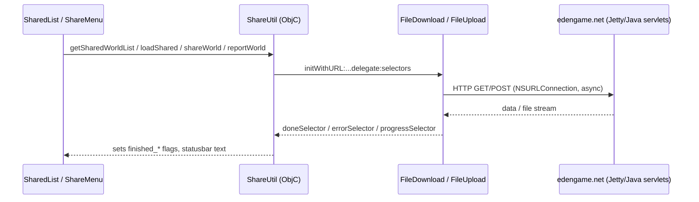

# Networking & World Sharing

## Purpose
The only networking in the game is the world-sharing service: upload a world + its
preview screenshot, browse/search/download shared worlds, report abuse. Plus
analytics (Flurry) and the long-dead TestFlight SDK.

## Architecture (stock client — not compiled on the port)

## The port's client (Stage 5.9, 2026-10-07)
None of the files below is compiled by the live port targets (they are NSURLConnection + UIKit and
seam-excluded). The port's browser is `Classes/WorldBrowser.{h,mm}` (docs/ui.md) over a tiny
non-blocking seam, `eden_net_fetch/poll/body/error/release` — implemented natively in
`port/src/seam/Net_native.cpp` over a backend chosen at build time: `AppleNet_native.mm`
(NSURLSession, macOS/iOS), `NetWinHttp_native.cpp` (Windows), `NetCurl_native.cpp` (libcurl, Linux),
or `NetNone_native.cpp` ("no network" — a Linux build without libcurl; Get Worlds is then not offered). A body kept in
memory (no `destPath`: the list and preview fetches) is capped at 32 MB (Q.6, `kMaxMemoryBody`); a world download goes
to a file and is not capped. It speaks the stock protocol to BOTH official services and adds the
community archive:

| Source | List | World | Preview |
|---|---|---|---|
| Current | `http://app2.edengame.net/list2.php?start=N&sort=2` (Recent), `?search=` (Search); `http://files2.edengame.net/popularlist.txt` (Featured) | `files2/<id>.eden` (gzip) | `files2/<id>.eden.png` |
| Legacy | the same paths on `app.` / `files.edengame.net` | `files/<id>.eden` | `files/<id>.eden.png` |
| Archive | `https://hagg3.github.io/edenarchive/assets/data/worlds.json` (JSON array) | `…/assets/worldfiles/<id>/<id>.eden.zip` (zip, sometimes zip-in-zip) | `…/<id>/<id>.eden.png` (often 404) |

**The list format, now traced (was "confidence medium" below):** plain text, `<id>.eden` and
`<name>.name` on alternating lines, no counts and no page size (Recent returned 150 per page and
Featured 100 on 2026-10-07; `popularlist.txt` repeats an id under two names). Parse by adjacency,
not by stride — a stray blank line would desync every later pair. `sort=2` is what the stock client
sends for Recent. From the 2015 server source (`edenweb/src/List2.java`; the live `app2` host may differ):
`sort=0` is alphabetical, `sort=1` is the same as 0 (a "Popular" sort was planned and never built;
Featured is the hand-curated `popularlist.txt`), `sort=2` is newest. A list is capped at **150** results
and `start=` is **ignored**, so there is no paging. Search is an OR word-index match, ranked by number
of words matched, then by date. Only the `files*`
hosts answer HTTPS (CloudFront); `app*` refuse TLS, so the client stays plain HTTP and iOS needs an
ATS exception for `edengame.net` (`NSAppTransportSecurity` in native/ios/Info.plist.in). Neither service
sends CORS headers, which is why the retired web build could not use them. Worlds can be large: the current server's first Featured world inflated to 1.88 GB
(2026-10-07). Report is not implemented on the port. **Upload is, since S.5c (2026-10-10)** — below.

### Upload: the pinned `upload2.php` contract (S.5c)
Pinned from stock 2.1.1 (`Classes/FileUpload.mm` + `zpipe.c`'s `compressFile`) and a capture of the
2026 client (VuencEdit); the same on both hosts:
- `POST http://app2.edengame.net/upload2.php?uuid=<UUID>` (**Current**) or
  `http://app.edengame.net/upload2.php?uuid=<UUID>` (**Legacy**). Plain HTTP, as for the lists.
- `Content-Type: multipart/form-data; boundary=0xasdfasdfasdfasdfasdf`, a real `Content-Length` (no
  chunking, no `Expect: 100-continue`).
- Part `uploaded`, `filename="file.bin"`: the world **gzipped** (`deflateInit2(…, 15+16, …)`,
  `Z_DEFAULT_COMPRESSION`). Stock gzips too — `FileUpload.mm` calls `compressFile` before the
  POST (the "uploads uncompressed" note under `FileArchive.mm` below is about that file only).
- Part `uploaded2`, `filename="image.bin"`: the preview PNG. Neither part has a Content-Type.
- The world's header `hash` (offset 96) carries the **MD5 hex of that PNG**, so the server can pair
  them (stock `ShareUtil`). The reply is the body `YES`.
- The **Legacy server takes Legacy64z only** (very old devices): the client forces that target there.

The port's side: `Classes/WorldShare.{h,mm}` (the menu's Share > Upload: server, format picker
defaulting to the world's own format, the pre-flight loss report as the confirm), the body built a
slice per frame by `emod::begin_upload_body` (`Classes/EdenWorldExport.cpp`) into
`<world>.upload-body` beside the world — the exporter streamed through gzip between the multipart
prefix and suffix, never a raw `.eden` on disk — then `eden_net_post_file(url, contentType,
bodyPath)` (`WorldBrowser.h`; native `Net_native.cpp` over the backend's `post_file`: NSURLSession
upload-from-file, libcurl `READFUNCTION` + `POSTFIELDSIZE_LARGE`, WinHTTP `WinHttpWriteData`), and
the temp is deleted. An upload needs `<world file>.png` (camera mode, 3:2 PNG ≤ 1440 long side, H.16; uploaded as-is, and its MD5 is the header hash); without it the action says
so. Fixture mode (`--net-fixtures`) answers a POST from `<root>/<host>/<path>` and saves the body
beside it as `<path>.posted`, which is how `--browser-selftest` and the `--upload-*` CLI
(native/README.md) check the bytes offline. **No live upload has been made by a harness**: one per
host is the user's to do. `--net-live-selftest` exercises the real servers' read side.

**Get Worlds converts (S.5).** A finished download is never unpacked to a `.eden`: `WorldBrowser`'s `DL_CONVERT` runs `emod::ImportJob` on it (layers unpacked still
compressed, the innermost stream converted), lands `<id>.emod` (or `<id>-N.emod`), and deletes the
download (`<saves>/.emod-download`; previews go to `.emod-preview.png`). The S.5 pre-flight free-space
check applies (docs/save-load.md "Converting, importing, pairing").

## Multiplayer transport and session (Stage MP, MP.1/MP.2)
Plain C++ in `port/src/net/` (no `Classes/` includes; compiled into `eden_native` via `EDEN_SHARED_OTHER`,
`ws2_32` on Windows). Wire spec: `ewb-server/docs/protocol.md`; plan: `WORKING/multiplayer-engine-plan-2026-10-17.md` §4.
- `NetSock` — non-blocking TCP (POSIX + Winsock): `tcpConnect` with a deadline and `CONN_DNS/REFUSED/TIMEOUT/OTHER`,
  `sendSome`/`recvSome` (`IO_WOULDBLOCK`, `IO_ERROR`, 0 = closed), loopback listen/accept for the selftests.
- `LineFramer` — `\n` framer. Cap 8192 bytes per line, 64 MB for a line starting `SNAPZ:`. A `\r` is kept (protocol).
  Once a line past 1 MB (`kShrinkAbove`) is consumed its buffer is freed (Q.6), as is the session's line string.
- `Snapz` — `SNAPZ:<count>:<b64>`: unpadded base64, raw DEFLATE, exactly `count*20` bytes of five LE int32
  (`x y z flag type`). Rejects a count the payload cannot hold (deflate caps at ~1032:1), short/long/trailing data.
  Records come out in wire order; merging a cell's flag 0 / flag 3 and bucketing by column is `MpWorld::mergeSnapz` (below).
- `MpSession` — one connection. `start()` runs a thread: connect (3 s) -> `JOIN:name:type:password:zr` (+ `SIGNQ`,
  `REGION` back to back, as retail) -> welcome (10 s) -> `PING` every 10 s, `PONG` silence > 30 s is `Lost`. Output is
  `MpSideEvent` (stage, welcome, rename, chat, spawn, caps, peer movement, pong RTT, the one terminal `Error`) and
  `MpWorldEvent` (`ACTION`, `SIGNP`, `SNAPZ`, in server order) queues drained by the main thread. `MpError` carries the
  UI plan §7 causes (`ServerFull`, `WrongPassword`, `InvalidName`+reason, `NoWelcome`, `ServerClosed`+last `[Server]` line,
  `Lost`, ...). Name/password with `:` are refused locally; `characterType` is clamped to 0..10; `zr` is sent verbatim.
- **Memory cap (Q.6, F21).** Every world event (`SNAPZ` records, and `ACTION`/`SIGNP` too) counts
  `MpSession::eventBytes` against `worldQueueCapBytes` (256 MB), together with what the consumer reports it still holds
  (`setHeldBytes`; the join flow passes `MpWorld::heldBytes()` = `MpWorld`'s queued events + the burst/reconcile cell sets
  every pump). So the cap spans drains, including while the load pthread runs and `MpWorld` cannot drain. Past it:
  `TooMuchData`.
- **Stopping (Q.6, F20).** `stop()` joins the thread. `detach()` (a session owned by a `std::shared_ptr`, as
  `MpLink_native.cpp`'s is) signals and lets go: the thread holds its own reference, finishes a connect or DNS lookup
  alone (`getaddrinfo` has no timeout), closes the socket and frees the session. So the Connecting window's Cancel never
  blocks the UI. A connect that completes after the stop does not send its `JOIN`. A stack session's `detach()` joins.
- Gates: `--net-selftest`, `--mp-selftest` (offline against an in-process mock, every CI leg) and `port/tools/mp-live-gate.sh`
  (both with `--server=` against a local `edenserver`). `feedLine()` runs one recorded line through the same parser with no
  socket (`--mp-replay`). The join flow that starts one is `port/src/seam/MpLink_native.cpp` (MP.3b, below); it runs
  `MpSession` with `joinBurst` off, so `SIGNQ` and `REGION` go out after `SPAWN`, at its lattice point.

## The session world (Stage MP, MP.3a)
`Classes/MpWorld.{h,mm}`; plan `WORKING/multiplayer-engine-plan-2026-10-17.md` §2, §3, §11. A multiplayer session has
**no file**. `FileManager::sessionWorld` is set by `MpWorld::beginSession(host, port, name)` and cleared by `endSession()`
(`World::exitToMenu`). The world's name is `mp:<host>:<port>`, which is never a path: every site that would open
`<docs>/<world_name>` checks `sessionWorld` first (`prepareAndLoadGeometry`'s two file handles, `takeScreenshot`).
- **The world** is the flat recipe (`TerrainGenerator::generateColumn`'s `LEVEL_SEED==0` branch: bedrock 0, stone 1-15,
  dirt 16-31, grass 32 — `ewb-server`'s base profile) at **256z** (`World::loadWorld` skips the height probe), seed 0,
  unbounded, Render distance **capped at 9** (one 128-block `REGION` lattice point covers that window, §6.1).
  `FileManager::loadSessionWorld` is the `.emod` loader's shape with nothing read: pos/home/yaw from `MpWorld::header()`
  (synthesised: `SPAWN` via `setSpawn`, else `(65536.5, 34, 65536.5)`), default region skies, no creatures, 0 golden cubes.
- **The overlay**: per chunk column (`cx<<15|cz`), a sorted `std::vector<uint32_t>` of `idx16<<16 | type8<<8 | colour8`,
  `idx = x*4096 + z*256 + y` (CC order at 256z). A cell equal to flat (recipe type, colour 0) is never stored. Cap
  `MpWorld::overlayCapBytes` (48 MB, `--mp-overlay-mb`): past it the non-resident columns farthest from the player go whole
  (the next `REGION` refills them).
- **Merging** (main thread): `mergeSnapz` takes one frame, buckets it by column and does one sorted merge a column. A *burst*
  is the frames up to and including the first with < 3000 records; the first record of a cell in a burst replaces what the
  overlay held, later ones (its flag 0 / flag 3 partner, possibly in the next frame) refine it. Flag 3 alone = the recipe's
  block, painted. Out-of-range cells (x or z outside 0..524,287, y outside 0..255) and bad values are dropped and counted.
  `applyAction` (overlay half of §8.2: a peer's build only into air or liquid, a mine makes air, a paint needs a block,
  a burn does nothing; `server` restores are raw) and `applySign` (SIGNP → the session trailer, text cut to 95) are the
  other two inputs. These are the offline path (`--mp-replay` legs 1, 2, 5); a live session queues (MP.3b, below).
- **Landing**: the flat branch calls `MpWorld::applyDelta(column, cx, cz)` after the recipe and **before** the `GBLOCK` copy
  and `addChunk`, so `blockarray`, R.2's `typesEmpty`, light, shadows and portals all see final voxels. `resetForReuse` zeroes
  `pcolors`, so a recycled slot never leaks paint. During the initial load this runs on the load pthread against a frozen
  overlay (nothing merges while `doneLoading==1`).
- **Commit to RAM**: `saveWorld()`/`saveWorld(warp)` (bulk reload, warp, Save, exit) and `saveWorldKeepDynamics()` (the ring's
  evict-save, autosave) call `FileManager::commitSession`: the header follows the player, then `MpWorld::commitModified()` diffs
  every resident column with a `modified` chunk against flat into its delta and clears `modified`. So local results nobody
  sent (fire, liquids, blasts) survive a walk out and back, as in singleplayer. Nothing reaches disk; the session trailer is
  kept across warps (`loadWorld` only clears it outside a session).
- **Off in a session (E11)**: creatures (`MpWorld::gateCreatures` under `SettingsMenu`'s write; the player's choice comes back
  on exit), command-block triggers and presses, console lines with a world verb (`tp set fill paint explode fire spawn time gold
  run if unless`: refused whole) and `world.*` writes, sky paint, Warp Home / Save Game (which sets home) / Take Photo (hidden in
  the pause menu; death still respawns at the session's home = `SPAWN`), golden-cube pick-up (a streamed one is walked through)
  and placement (purse 0), the H.8 fire rules (`eden_reapply_fire_flags`).
- **Gate**: `--mp-replay=port/tools/fixtures/mp/replay-1.lines` (every CI leg, iOS-sim included). The fixture is a real
  `edenserver` stream recorded by `port/tools/mp-replay.py record` (a builder edits near the spawn and a far point, a recorder
  joins, asks two `REGION`s and sees five live `ACTION` relays; the spawn reply is three frames with a flag 0/3 pair across a
  boundary). Its `.expect` is `mp-replay.py expect`'s own decode over flat (`--check` in CI). Legs: 1 the joined window's hash
  equals it; 2 local edits survive a walk out of the window and back (`--mp-mutate=noevictcommit` fails); 5 a teleport's bulk
  reload equals the expected window there and a fresh join at it (`--mp-mutate=nolandhook` fails 1 and 5); plus the gates above
  and "nothing written to the save directory".

## The live world (Stage MP, MP.3b)
Plan §5-§7; code `Classes/MpWorld.cpp` (second half), `Terrain::setCellState`, `port/src/seam/MpLink_native.cpp`.
- **The link.** `MpWorld::Link` (`pump`, `sendLine`, `release`) is the host's half; MpWorld owns it from `setLink` and calls
  `pump()` once a frame from `MpWorld::tick()`, which `World::update` calls first in **every** mode (menu, play, under a
  `GLDialog` or Settings): so no host loop needs a hook. `release()` comes from `dropLink()`/`endSession()` (deferred to the
  end of the tick when called inside `pump`). The native link drains `MpSession`'s queues into `enqueueSnapz/Action/Sign`.
- **The queue.** The world stream is applied in server order, FIFO: an event the budget defers holds back everything behind
  it. A SNAPZ frame merges its columns that are not resident at once (`mergeRecs`, cheap) and walks its resident cells one
  at a time (a cell's adjacent flag 0/3 records coalesce); an `ACTION` on a resident cell is §8.2's rule on the chunk's state;
  `SIGNP` upserts the trailer (`SignRenderer` reads it each frame). Bursts end explicitly: the pacer queues an `EndBurst`
  behind a frame of < 3000 records, or after 300 ms of quiet.
- **Step 5c** (`MpWorld::update`, after `CmdScript::update`, before `prepareAndLoadGeometry`; also in the two modal
  early-outs): play only, never while `doneLoading`. Budget **2 ms or 24 dirtied chunks** (a write counts its chunk and the
  6 neighbours `updateChunks` queues; one write may overshoot by 6). A backlog older than 2 s shows "Syncing..." in the HUD
  status bar. Before the window loads, `tick()` drains into the overlay at **8 ms** a frame (the join's Syncing step).
- **Resident writes** go through `Terrain::setCellState(x,z,y,type,colour)` (factored out of `CmdScript`'s `setCell`, which
  keeps its refusals): liquid source out/in, lightbox light out/in, `updateChunks` (air drops signs and `CMB1`), the paint,
  `refreshChunksInRadius` for lights. No particles or sounds. That is how restores and a peer's builds land; a peer's mine,
  burn and paint use the engine's primitives since MP.4 (next section).
  The chunk goes `modified`; the overlay of a resident column is only made exact by a commit.
- **The pacer** (VuencLink `region.rs`'s rules): the point is `128·floor(p/128+½)` on each axis, switched when the player is
  more than 72 blocks from it; re-asked every time it becomes current (never deduplicated); one request in flight; 750 ms
  after a reply ends; no frame within 3 s = *unanswered* (not empty), re-asked after the gap, 3 times, then left until the
  point changes; points outside 0..0xFFFFFF never sent. `serverSpawn` (a mid-session `SPAWN`) warps and sets the point.
- **Reconcile** (§6.3) when a reply that answered our `REGION` is applied: every cell of the columns within ±208 of the point
  that the burst didn't name (nor an `ACTION` relayed inside it) goes back to flat — resident columns are committed first,
  then written cell by cell under the budget; non-resident ones lose the entries in one pass. Spared: cells
  `noteLocalEdit` (MP.4's intent sites) stamped at or after that `REGION` went out; stamps older than it are pruned.
  Q.6: a session that never completes a reconcile would grow the stamps forever, so past 65,536 `noteLocalEdit` also drops
  stamps older than 60 s (the next sweep waits for twice what survived, so a big fill stays linear).
  `--mp-reconcile=0` turns it off; an unsolicited burst (legacy push, a late reply) merges without reconcile.
- **The join** (`MpLink_native.cpp`, §7): Connecting → welcome → `CAPS:region` then ≤ 500 ms for `SPAWN` (no CAPS in 1 s =
  the legacy push: no `REGION`) → `beginSession`, `setSpawn`, `SIGNQ`, `startRegions` → Syncing until `joinReady()` (the
  first reply applied, or its point unanswered 3 times) → `openSession` (Loading) → Play (`setPlaying`; an `[mp] mp.join`
  line with the phase times). A failure before Loading puts "Couldn't join: ..." on the menu status bar; in play (or once a
  load that failed lands) the "Disconnected" dialog offers **Reconnect** (a fresh join after `exitToMenu`) and **Exit**.
  Entry: `eden_mp_join(host, port, name, type, password)`; `--mp-join=HOST[:PORT]` (interactive, or `--headless` as a gate).
- **Gates**: `--mp-replay` leg 3 (a `server` restore and peer edits land in the frame they drain; a refused local mine and a
  re-`REGION` → grass again; a cell edited after the `REGION` is spared, and reconciled by the next reply; walking 80 blocks
  asks the next point, 3 unanswered asks, then quiet; walking back re-asks; `--mp-mutate=noreconcile` fails) and leg 4
  (614,400 records through the whole join flow, an `mp.join` line; a 2,000-cell relay storm, an `mp.storm` line; ≤ 24
  chunks a frame). Live: `port/tools/mp-replay.py live --edenserver PATH` (Emod's joined window hash = the tool's decode of
  a recorder client's reply). Mac numbers 2026-10-17: 614k records decode 23 ms, sync 25 ms over 3 frames (worst 12.7 ms),
  playable 100 ms; storm 32 frames, worst 1.7 ms; live join to a local server 101 ms.

**Noclip in a session (FM.2).** Allowed: noclip is purely client-side (`Player::noclipUpdate`, `docs/player-input-camera.md`), and a vanilla server only sees the positions we send, including ones inside blocks, with no way to object. Golden cubes are scenery in a session anyway, and noclip fires no portals.

## Edits out and in (Stage MP, MP.4)
Plan §8-§10; code `MpWorld::intent*` (end of `Classes/MpWorld.cpp`), `applyActionLive`, `Terrain::update`'s burn list,
`SignTool::answer`.
- **Out, at the intent sites.** `Player::processInput`'s build (tap, jump-and-build, every sub-cell of the H.7 double brush),
  mine, burn and paint, and the portal exit's two clearing mines, call `MpWorld::intentBuild/Mine/Burn/Paint(x, z, y)` (Terrain
  order) in place of the `Terrain` call. Outside a session that is the plain call. In one, the target and y ± 1 are read
  before and after, and each cell that changed sends one line: became air → `ACTION:x:y:z:1`; another type → `…:0:<type>`
  then `…:3:<colour>` if painted; same type, another colour → `…:3:<colour>`. Paint left on air (`destroyBlock` keeps it for
  TNT colour) is not an edit. So a door or portal goes out as both halves (U1: retail unknown), a ramp as its oriented id.
  Each sent cell is stamped `noteLocalEdit` (reconcile's exemption).
- **Burns (E10).** `intentBurn` sends `…:2` only for an `IS_FLAMMABLE` target (the server deletes whatever it is told to
  burn) and sets the cell's `BurnNode::mpLit`. In `Terrain::update`, a node with `mpLit` whose fuse runs out on time
  (`time <= 0` with the cell still solid) calls `MpWorld::burnFuseOut` → `…:1`, before the blast. A node ended by its cell
  going air first (a restore's or a peer's mine) sends nothing, so a refused burn is never mined again by our echo. Spread,
  blasts, fills and the 300-fire valve are never sent: the server simulates them, reconcile settles the difference.
- **Signs in** (fixed 2026-10-17): `applySign` adds a server's sign with `addSign(…, asIs)`, keeping `a/b/c` as sent (server sidecars
  carry `b = 0`, which the editor's range check refused, so those signs never appeared), and cleans the text to SGN1's 95
  printable ASCII (a UTF-8 sequence → one `?`; the server allows 256 bytes of any non-control text).
- **Signs.** `SignTool::answer`, after a successful place or edit, sends `SIGNP:x:y:z:a:b:c:text` (the sign as stored: the
  wire's y is the trailer's z, §10). An emptied sign (removed) sends nothing, as retail.
- **In.** A `server` restore and a peer's build stay state-level (`setCellState`). A peer's mine is `destroyBlock` (break
  particles, door/portal pairs, light, liquid source; a mine on air is nothing), a burn `burnBlock(FALSE)` on a flammable
  resident cell (the fire, blast, firework or fill runs here, as on every retail client; nothing is sent, `mpLit` stays 0),
  a paint `paintBlock` on a non-air cell (doors in pairs; colour 0 strips). Non-resident cells keep the overlay rules.
  These are engine primitives, never `intent*`, so a relayed edit cannot be sent again.
- **Gates.** `--mp-replay` leg 6 (the lines each intent sends, E10's three cases, the sign line, a peer's paint/mine/burn
  through the engine, nothing sent while applying them; `--mp-mutate=echo` fails it; an `mp.edits` line). Live:
  `port/tools/mp-replay.py edits --edenserver PATH` runs a watcher and a builder Emod plus a recorder socket: the watcher's
  window from the relays alone, and both after a closing reconcile, equal the tool's decode of a fresh `REGION`; every
  `ACTION` the builder sent is relayed exactly once and the watcher sends none (`--mutate echo` fails); the sign reaches the
  watcher, the relay and `eden_signs.txt` unchanged.

## Remote players (Stage MP, MP.5)

Other players arrive as `POS` / `VEL` / `POSVEL:name:type:…` lines (the server never echoes a sender's own), become side events
(`MpSideEvent::Peer`), and `MpLink_native` hands them to `MpWorld::peerSeen` (skipping our own name). Engine order (y up), blocks/second.
- **Peers** (`MpWorld.cpp`, up to `MAX_REMOTE_BODIES` = 16, the rest not drawn): last report (`target`, `vel`) and a shown `pos`.
  Each frame (`update()`, play only) `pos` glides (rate 10/s) to `target + vel × age` (age capped at 0.6 s); farther than 12 blocks = snap.
  Yaw follows the horizontal velocity heading (the player's yaw convention), motion = jump if |vy| > 2, walk if h-speed² > 0.25.
  A peer is dropped by the server's `<name> has left.` (a `[Server]` chat line → `peerLeft`) or after 30 s without any line.
- **Avatars**: `Model.cpp` `REMOTE_BODY(i)` slots after the H.12 `PLAYER_BODY`, same rules (outside every `i<nguys` loop, never saved, never
  picked, `PoseBody` shared with `UpdatePlayerBody`). `characterType` 0..10 → one of the 7 shipped models (`MpWorld::avatarModel`:
  Green, Moof, Batty, Nergle, Stumpy, Charger, Stalker, then Green, Moof, Batty, Nergle; the meaning of vanilla's types is unsettled).
  **A session now loads the creature models** (`World.cpp`: `CREATURES_ON || MpWorld::active()` at load, unload and `RenderModels`) although
  creatures stay off (E11); `PlayerBodyAvailable` accepts the same.
- **Name tags**: `MpWorld::renderPeerTags` from `Hud::render` (before the status toast; not in camera mode or with the UI hidden): the head
  point is projected by hand from `Camera::viewPoints`, `eden_fov_degrees` and `P_ASPECT_RATIO` into the HUD point space; a `GLW::Label` in a
  dark pill, 64 blocks range. **Tags are not occluded** by terrain. The hand projection must use `gluLookAt`'s basis (side = forward × up,
  up' = side × forward): MP.12 used up × forward, which negated both axes and mirrored every tag through the screen centre, so a tag
  looked right only on a peer dead ahead (FT.11). The tag's centre is then passed to the GLW kit in **point space**: `GLW::fill`, `Label`
  and `Texture2D::drawText` multiply by the 2×-UI factor themselves (`IS_IPAD` is true on every port target), and MP.12 pre-multiplied, which
  drew tags at twice their distance from the bottom-left corner, usually off screen (FT.11's second bug). `--mp-replay` leg 7 checks the
  projection against `gluProject` through project.c's matrices, and with `--windowed` also the drawn pill's pixels (median of the pixels
  a tags-on frame adds over a tags-off one), in first and third person.
- **POSVEL out**: `update()` sends the player's `pos` + `vel` at ≤ 4 Hz while either moved (> 0.01), else 1 Hz (which keeps the server's saved
  position fresh and peers' 30 s timer from firing). `--mp-replay` leg 7 pins the rates, the format, the glide, the snap and leaving.
- **Left for later:** no avatar for the vanilla-only models; peers show no hit/burn/edit animation; tags ignore terrain; who is online is
  "seen" only (MP.7's list).

## Server list and join screens (Stage MP, MP.6)

The home **Multiplayer** tile opens `Classes/ServerListMenu` (list, detail pane, Connecting window, error dialogs) and
`Classes/ServerFormMenu` (Add/Edit server, Profile). They reach the network side only through the C seam
`Classes/MpServers.h` (implemented by `port/src/seam/MpServers_native.cpp` over `port/src/net/ServerList`, and by
`MpLink_native.cpp` for the join's progress), so `Classes/` still never includes `port/src/net`.
- **`servers.txt`** sits in the documents root (`eden_platform_documents_root()`, so `--docs` isolates harness runs):
  header `emod-servers 1`, then `label<TAB>host<TAB>port<TAB>password<TAB>cache`; `cache` is `k=v;…` (keys `name`, `motd`,
  `flags`, `players`, `max`, `locked`, `seen`), values percent-escaped (`% ; = TAB CR LF`). Unknown keys and unparsable lines
  are kept and written back. ≤ 100 rows; written tmp + rename (Windows removes first). A password containing `:` is
  refused (the JOIN line is `:`-separated).
- **Probe** (`probeServer`, `ServerProber`): TCP connect (ping = connect time, 3 s), send `INFO\n`, read one line for 1.5 s.
  `INFO:` → Online (name, motd, players/max, locked, flags; remote text is capped and cleaned), `[Server] Server full.` →
  Full, anything else or silence → "Online, no details" (a vanilla server). Never sends JOIN. ≤ 8 probes in flight on
  lazily started worker threads that only turn sockets into plain results (drained on the main thread by
  `eden_mp_servers_poll`); a generation counter drops results after a cancel. Probes run on open and on Refresh only, no
  polling. A good INFO overwrites the row's cache (`seen` = now); a blank label takes the INFO name.
- **Profile**: `mp_name` / `mp_character` (0..6) in the prefs store (`eden_prefs`, G.2b-1; NSUserDefaults before); the first join asks for a name first.
- **Join**: `eden_mp_join` → `MpLink_native`, whose stages (`EDEN_MP_JOIN_*`: Connecting, Joining, Receiving world,
  Loading world + %, Playing, Failed + `EDEN_MP_ERR_*` + sentence) drive the Connecting window. A locked row without a
  remembered password prompts first (secure field, "Join and remember"); a wrong password marks the row locked and prompts
  again. Cancel works until Loading. Escape/Back goes form → cancel join → home (`eden_server_list_back`).
- **Harness**: `--mp-mock` / `eden_mp_servers_mock(1)` is a 7-row fixture with canned probe results (no sockets, nothing
  written; 2 = empty list). `--shot` captures `mp-*`; `--ui-selftest` drives add/validate/save, profile-first join,
  Connecting + Cancel against a silent listener, delete, the secure prompt and the keyboard rule; `--mp-selftest` covers
  the file format, address/name rules and the probe against mock sockets.
- **Left for later:** the `INFO` verb on the server side (MP.9; until then every server reads "Online, no details"); the
  pause menu still says "Exit" in a session. The text raster is ASCII-only, so non-ASCII remote names/MOTDs degrade.

## Matchmakers (Stage MP, MP.8)

- **Setting**: Experiments › Matchmakers, `mp_matchmakers`, the port's first **`KIND_TEXT`** row (`Settings.cpp`: value in
  `g_text[]`, persisted as an NSString under the key, `eden_settings_text` / `eden_settings_set_text`; not a Console cvar, and
  `eden_settings_set` ignores it). Comma-separated `host[:port]`, default port **27020**, ≤ 8 addresses, ≤ 512 bytes, empty = off.
  `SettingsMenu` shows a button ("None, Add" / "2 addresses, Edit") that opens `GLDialog::prompt`; Save validates the whole list
  with `parseMatchmakers` (the server form's address rule) and a bad entry rejects it with a dialog naming it. The stored text is
  the cleaned `host:port, host:port` form.
- **Fetch** (`port/src/net/ServerList`): `fetchMatchList` = connect (3 s), `LIST\n`, read `SERVER:<name>:<ip>:<port>:<locked>[:<players>[:<flag6>]]`
  lines (the 4-, 6- and 7-field forms) to `END` (5 s), close. `MatchFetcher` runs one short-lived thread per address (≤ 8), results
  are plain data on a locked queue drained by `eden_mp_matchmakers_poll`; a generation counter drops results after a cancel. It runs
  when the Matchmakers tab is shown and on Refresh, never polled. Rows from all matchmakers merge, de-duplicated by `ip:port`, players
  descending then name; a matchmaker that fails adds to "n of m matchmakers did not answer" (the empty state).
- **Screen**: with at least one address the list screen's titlebar shows a `TabRail` **My servers · Matchmakers** in place of the
  title. A listing is a row with no ping (name; `host:port - via <matchmaker>`; players; lock), the pane says what little it knows, the bar
  is **Save** (copies the row into `servers.txt` with its name, lock state and a probe, then shows My servers with it selected) ·
  Refresh · **Join** (a direct connect: a locked listing prompts for the password, a failure offers "Save server"). Plan §2.3's per-matchmaker
  group headings are not drawn; the source is on each row's second line.
- Seam: `Classes/MpServers.h` `eden_mp_matchmaker*`; `--mp-mock` gives two addresses and four canned listings.
  Gates: `--ui-selftest` (setting cleaned / rejected / capped, tab, sort, Save), `--shot` `mp-list-matchmakers`.

## Chat (Stage MP, MP.7)

- **`Classes/ChatFeed`** owns the chat: a 200-line scrollback (`Console::Line` kinds `K_CHAT` / `K_SERVER` / `K_SELF` / `K_CMD` / `K_NOTICE`),
  the HUD feed, sending and the touch button. `MpLink_native.cpp` feeds it (`addWire`: relayed chat as `name: text`, `[Server]` lines
  with the welcome and MOTD kept in the scrollback); `MpWorld::beginSession` resets it.
- **Sending**: `send()` strips control bytes, trims, cuts at 256 bytes (UTF-8-safe), and sends `MSG:text` through `MpWorld::link()`. Plain
  text is echoed at once as `You: text` and passes a client bucket (0.5/s, burst 5, the server's defaults); a refused line (`TOO_FAST`)
  stays in the field with a red notice line. A line starting `/` is a server command: exempt from the bucket, echoed as `> /cmd`,
  and `/login …` is echoed `> /login ****` and never kept in the Up/Down history (50 lines).
- **HUD feed** (`ChatFeed::renderHud`, from `Hud::render` after the peer tags, so Hide HUD hides it): top-left of the safe rect under the
  pause gear, ≤ 45% of the safe width / 420 pt, the newest 5 lines (3 on a screen under 360 pt high), each on a dark 85% backing, fading
  after 10 s; `[Server]` amber, own lines lime. It claims no touches. It is not drawn while the Console screen is open.
- **Panel**: the Console screen. In a session the rail has five tiles, **Chat · Players · Console · Variables · Help**, and `T`
  (keybind `chat`), `/` (`chatCommand`; opens with `/` typed) and the touch chat button (right of the pause gear; `ART_CHAT` art since 2026-10-27, dimmed while held; lime dot for unseen
  lines) open it on Chat via `eden_chat_open`; the `` ` `` key and the pause menu's Console button still open it on the Console tile. The
  Chat tab is the Console tab's scrollback + field with `ChatFeed`'s lines; Chat and Console keep separate drafts in the one field.
  Desktop closes the panel after a send (and on Enter in an empty field); touch keeps it open. On touch the field is prose (autocorrect
  on) until the text starts with `/`; desktop stays in code mode so Tab (complete a player name) and Up/Down (history) reach it.
- **Players tile**: you, then the players `MpWorld` currently tracks (joined, moved or spoke; dropped on `has left.` or 30 s of silence),
  with the distance in blocks. A tap puts `/msg name ` in the chat field. The protocol has no who-is-on query, so this is "seen",
  not "online".
- Not built (plan §8.4): the hold-Tab player overlay, "server reports n" in the Players header (needs MP.9's `INFO`), the model name per
  player, and Chat-specific `--shot` pages (`hud-chat`, `chat`, `players`; they need a live session).
- Gates: `--mp-replay` leg 8 (lines in, `MSG:` out, `:` safe, the bucket, `/login`, the panel, Players, the feed's cap and fade).

## Port-side files and gates

Moved from `port/CLAUDE.md` (2026-10-20). `port/src/net/`: `NetSock` (TCP, POSIX + Winsock), `NetFramer.h`,
  `Snapz`, `MpSession` (network thread + queues). Plain C++, no engine includes; gates `--net-selftest`/`--mp-selftest`
  (Q.6's `legRobustness`: framer shrink, `ACTION` counted, held bytes across drains, `detach()` mid-connect; `--mp-replay`
  leg 4 checks `MpWorld::heldBytes()` counts the 614k-record burst and returns to 0),
  `tools/mp-live-gate.sh`. See `../docs/networking.md` "Multiplayer transport and session". MP.3a's session
  world/overlay is engine code (`Classes/MpWorld.*`); `MpSession::feedLine` drives the parser socket-free for
  `--mp-replay`, whose fixture `tools/fixtures/mp/replay-1.{lines,expect}` is recorded and independently
  checked by `tools/mp-replay.py` (`record` against a local edenserver, `expect --check` in Linux CI). MP.3b: the
  join flow is `../port/src/seam/MpLink_native.cpp` (an `MpWorld::Link`: MpWorld pumps it each frame from
  `World::update`, so no host-loop hook; `--mp-join=HOST[:PORT]`, `eden_mp_join()`); `tools/mp-replay.py live` joins a
  local edenserver headless and checks the window hash; MP.4's `tools/mp-replay.py edits` runs two Emods (`--mp-edits`
  builder, `--mp-hold=FILE` watcher) and a recorder socket against one (converge, relayed once, no echo, the sign round-trips).
  MP.6: `ServerList` (servers.txt format, address/name rules, `INFO` probe, `ServerProber` worker pool), reached from
  the screens via the C seam `Classes/MpServers.h` = `../port/src/seam/MpServers_native.cpp`; Escape on the list is
  `eden_server_list_back()` (Menu.cpp); `--mp-mock` is the canned fixture. MP.8: `fetchMatchList`/`MatchFetcher`/`parseMatchmakers` in the same file, `eden_mp_matchmaker*` in the seam, and `Settings.cpp`'s first `KIND_TEXT` row (`mp_matchmakers`; not a cvar). MP.7: `Classes/ChatFeed` + the Console screen's Chat/Players tiles; keybinds `chat` (T) and `chatCommand` (/) dispatch `eden_chat_open` (Menu.cpp); the UI atlas grew to 512x512 (`ui-icons.py`).

## Client files (stock; seam-excluded on the port)
- `Classes/ShareUtil.mm` — endpoint knowledge and orchestration. Current endpoints
  (the `static NSString*` URLs near the top; note this community fork repointed them, and the file
  preserves the historical endpoints in comments — a little archaeology of the
  service's hosting history):
  - `UPLOAD_URL  = http://app.edengame.net/upload2.php?uuid=<identifierForVendor>`
  - `LIST_URL    = http://app2.edengame.net/list2.php?start=N&sort=N` (also `?search=`)
  - `REPORT_URL  = http://app2.edengame.net/report.php?map=<file>&uuid=<...>`
  - `MAPS_URL    = http://files2.edengame.net/<file>` (worlds and `<file>.png` previews)
  - `POPULAR_URL = http://files2.edengame.net/popularlist.txt`
  - "php" names notwithstanding, the server implementation upstream (`edenweb/`) is Java.
  - `gzipInflate` exists for gzip-compressed downloads.
- `Classes/FileDownload.mm` — thin async NSURLConnection wrapper: streams to a file
  (`NSOutputStream`) or accumulates `result` NSData when `filePath` is nil;
  delegate + `doneSelector/errorSelector/progressSelector` pattern; cancellable
  (used when the user backs out of a download).
- `Classes/FileUpload.mm` — multipart/form-data POST of the world file **and** its
  `.png` preview in one request; same delegate pattern.
- `Classes/md5.c` — hashes the preview screenshot; the hash is stored in the world
  header so the server can pair/verify world↔preview. (Seam-excluded on the port; `port/src/shim/foundation/md5.cpp` replaces it.)
- `Classes/FileArchive.mm` — zlib world compression; **fully commented out** in this
  version. Uploads are still gzipped: `FileUpload.mm` calls `compressFile` itself (S.5c).

## Data formats
- The world list response is a text blob parsed by `SharedList` into
  `SharedListNode{value(downloads), name, file_name, date}` rows. (The format is traced in
  "The list format" above.)
- Stock: downloads land directly in Documents under the shared file name, then appear as
  normal local worlds (stock 2.1.1 reads only 64z, so later 256z worlds were height-truncated;
  the port reads 256z).
  Previews download to `Documents/temp`.
- **Port (`Classes/WorldBrowser.cpp`):** converts while inflating to `<id>.emod` (above);
  the plan was `WORKING/emod-format-implementation-plan-2026-10-03.md` §4 *Downloads and imports*.

## Server side (not in this repo)
The upstream source tree carries the Java servlets (`List2.java`, `UploadMap2.java`, `Report.java`,
`Moderate.java` under `edenweb/src`, deployed on a bundled Jetty, plus `jetty9/` and the old
website); this repo does not. Here only `tools/eden2/src/List2.java` and `UploadMap2.java` (with an
`Archive.zip`) survive. Useful as the ground truth for request/response formats if you rebuild
the service; the community keeps a compatible service alive (this fork's modified
download path targets it).

## Identity & moderation
No accounts. The device's `identifierForVendor` UUID accompanies uploads and reports
(pre-iOS6 devices send a placeholder string). `report.php` + `Moderate.java` implement
the flag-and-review loop (upstream); `report_flag.png` in the repo root is the client asset. Report is not
implemented on the port.

## Common pitfalls
- (Stock client.) All completion happens via selectors on the main run loop; the UI polls
  `finished_*` BOOLs each frame rather than using callbacks end-to-end — set the
  flags *and* the data before returning from a done-selector.
- (Stock client.) `ShareUtil` reuses a single `dlmanager`; starting a new request cancels the old
  one — don't fire two concurrent downloads.
- Plain HTTP; modern iOS requires an ATS exception — `native/ios/Info.plist.in` carries one for
  `edengame.net`.
- Stock: the upload sends both files even if the preview is missing; sharing without ever
  entering camera mode uploads a stale/absent png. The port's Upload refuses without a `.png`.

## Safe vs. risky to modify
- **Safe:** endpoint URLs, list parsing, UI feedback.
- **Caution:** the multipart body construction (`FileUpload`; on the port `emod::begin_upload_body`,
  pinned above — the server is picky),
  the delegate/selector lifetimes (manual retain/release; over-releasing the
  manager after cancel is an easy crash).

### Q.1a notes (2026-10-21)
- **Q.1a:** F22 `MpWorld::enforceCap` keeps a running byte count instead of rescanning the overlay per erase. F23 (Get Worlds) the download temp is per job (`.emod-download-N`); the browser sweeps leftover `.emod-download*` files when it opens idle.
