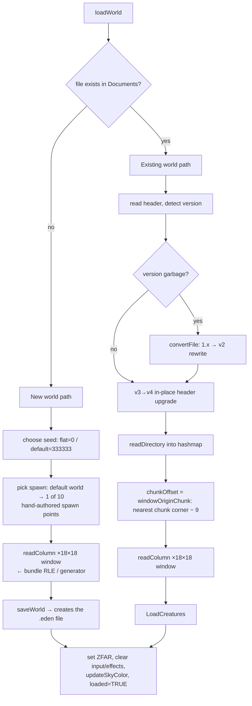

# Save / Load Pipeline

> ## Stage S / S.8 (2026-10-11): `.eden` is no longer created, played or saved
> **Every world is an `.emod`.** A `.eden` (or `.eden.gz` / `.gz` / `.zip`) is only ever a *source*: it is listed,
> flagged, and converted to `<stem>.emod` when played (S.5d, on every target); the
> `.eden` is never opened for update. `.emod` → `.eden` / `.eden.gz` **export** stays (Share › Export, `--export`,
> and the upload path). Deleted with S.8: `g_world_format` and its Settings toggle, `--world-format=` (still
> *accepted*, ignored), `EDEN_NO_CONVERT`, the `.eden` branch of `saveWorld`/`loadWorld`, `saveColumn`,
> `saveCreatures`/`LoadCreatures`, the pre-v1 `convertFile`, the B5 rollback journal + whole-file scratch copy
> + `recoverInterruptedSave`, and `--save-inplace`. **Sections below that describe the `.eden` load flow, the
> two save strategies, the journal and `convertFile` are historical** -- they document stock/early-fork
> behaviour that no longer exists in `Classes/` (`git show 35ecf78:Classes/FileManager.mm` has it). What stays
> in `FileManager.cpp` for `.eden` is read-only: `getName`/header peeks for the world list, `probeWorldHeight`,
> the converter's source side, and the directory/`readColumn` machinery that `writeGenToDisk` (offline worldgen)
> and the bundled-map reader still use. `convertWorldTo64` routes an `.emod` to
> `convertEmodTo64` (X.9, 2026-10-12): Legacy64z export to a scratch `.eden`, `ImportJob` with upgrade off, one atomic replace.
> It has no native UI caller yet (the retired web Storage tab's "Convert to 64z" was the only one; a native
> Storage page is ROADMAP W.6) — `--convert64-selftest` drives it.

## Purpose
How world files are opened, streamed, saved and migrated at runtime. The on-disk
format itself is specified in [eden-file-format.md](eden-file-format.md).

## Important files & types
- `Classes/FileManager.cpp/.h` — everything: `loadWorld` (routes to `loadEmodWorld`), `saveWorld` /
  `saveWorldKeepDynamics` (both end in `saveEmodWorld`), `readColumn`,
  `convertStep` (convert-on-play), `renameWorld`/`deleteWorld`, the read-only `.eden` directory
  machinery, plus the offline `saveGenColumn`/`writeGenToDisk` used by the world generator.
  (`saveColumn` and `convertFile` were deleted with S.8.)
  **Since G.2b-2 (2026-10-24) `FileManager.h` is plain C++:** every name/path parameter is a
  `const std::string&`, `documents` is a `std::string`, and a `std::string` return of `""` means what
  `nil` meant (`pairedEmodFor`, `originalOf`, `conversionError`, `pendingOriginal`; `getName` for a
  name that isn't valid UTF-8). The column readers take an `EdenFile*` (`port/src/shim/foundation/eden_fs.h`)
  instead of an `NSFileHandle*`; null still means "no `.eden` to read from".
  **Since G.2b-4 (2026-10-24) both files are plain C++ (`.cpp`), Foundation-free:** paths are
  `std::string`, directory work is `eden_fs_*` (`eden_fs_list` is sorted, where Foundation's order was
  unspecified), the bundle lookup is `eden_bundle_path` (`""` on a miss) and every `.eden` read/write is
  an `EdenFile` (null on a missing file, no backups: D5). Rules the port kept, so the bytes did not move:
  the header's `name`/`hash` are written with `eden_cstr_copy(…, 49/33, …)` (`getCString:maxLength:`'s
  empty-on-overflow, D4); a display name or hash with no UTF-8 form is treated as the old `nil` (`fm_ns`:
  a nil display name leaves the header's name alone, a nil hash writes an empty one); the static
  `.eden` handle's calls go through `fh_*` wrappers that are no-ops on null, as messages to a nil
  handle were; a converted world's `.png` is moved only if the target name is free (Apple's
  `moveItemAtPath:` never replaced). `loadGenFromDisk` (dead, `JUST_TERRAIN_GEN` 0) keeps its stock
  UIImage/CoreGraphics body under `#if 0`. Proof: the save/format gates plus a byte A/B against the
  pre-change binary (`.eden` → `.emod` conversion both answers, `.emod` → `.eden` export own and
  Legacy64z: identical; engine saves identical up to the creature records, which vary between two
  runs of one binary).
- `Classes/FileManagerHelper.cpp` — read-only access to the **bundled** default world (its own
  state; the comment at the top warns the identically-named statics refer to the *default*
  world, not the active one). **Since S.6 (2026-10-10) the bundled map is `Eden.emod`**
  (repo root; 11.8 MB, 32,400 columns, 4 bands, zstd-19, baked from `Eden.eden` by
  `port/tools/emod.py bake-default` and checked by `verify-default`). `fmh_init()` opens it with
  `emod::EdenWorldStore` read-only, in place — on every target, iOS included — and falls back to the
  RLE `Eden.eden` handle/directory only when the bundle has no `Eden.emod`. The zstd decode runs in
  `fmh_readColumnRawFromDefault` (main thread: the store is single-owner) and hands the worker's
  `fmh_decodeColumnBands` ready-made planar bands, flagged `FMH_LEN_PLANAR` in `lens[]`, so the
  decode step is a copy rather than an RLE expansion + `CC(y,z,x)` transpose. Stage 4.4's
  `Eden.eden.gz` and the 52.5 MiB `<documents>/Eden.eden.cache` it inflated are gone; `fmh_init()`
  deletes a leftover cache once. Gate: `eden_native --bundled-map-selftest` decodes all columns both
  ways through the engine (`fmh_selftestCompare`).
- `Classes/hashmap.cpp` — int-keyed hashmap holding `ColumnIndex*` records.
- File-scope statics in `FileManager.cpp`: `saveFile` (an `EdenFile*` since G.2b-4), `sfh` (in-memory
  header), `indexes` (directory hashmap), `cur_dir_offset`, `file_version`,
  `imgHash` (a `std::string`, `""` = none), and since Stage S/D `emodStore` (the open `EdenWorldStore`), `emodHeader`, `worldTrailer`.
  **The FileManager is effectively a singleton with global mutable state**
  — two worlds can never be open at once.

## Load flow — `FileManager::loadWorld(name, fromArchive)` (stock `.eden` flow — historical)

> The live path: `loadWorld` sends an `.emod` to `loadEmodWorld` ("`.emod` worlds" below); a `.eden` is
> converted first by `convertStep`. The chart is the stock 2.1.1 `.eden` flow, kept for reference.

Notes:
- New-world types: the `g_terrain_type` switch is hardwired to 9 (`gen_default`);
  types 0–8 (dirt/rivers/mountains/desert/ponies/beach/mix/flat) are the offline
  generator's biome recipes and are only reachable by editing the code. The menu's
  "flat world" option sets `genflat` → seed 0.
- The 10 default spawn points (`spx/spz/spy/spyaw` arrays in `FileManager::loadWorld`) are
  hand-picked scenic locations; consecutive new worlds avoid repeating the last one.
- `player->pos`/`yaw`, `home`, seed, golden cubes, region sky colors all come from the
  header. `chunkOffsetX/Z` (the render-origin/streaming anchor owned by FileManager)
  is derived from the player position, through `windowOriginChunk` (B.5b-1a: corner-centred, and the
  same helper the streamer uses). Since B.5b-1a the streamer moves it on every window shift, not
  only on a bulk reload (docs/world-and-terrain.md "Streaming").

## Column streaming — `readColumn(cx, cz, file)`

Resolution order for a requested column:
1. **Directory hit** → seek `chunk_offset`, read 4 chunks of raw type+color bytes
   into the (reused) `TerrainChunk` objects, memcpy type strips into `blockarray`,
   `ter->addChunk(...)` marks the chunk + neighbours dirty for meshing.
2. **Directory miss, seed == 333333** → `fmh_readColumnFromDefault`: same procedure
   against the bundled map (`Eden.emod` since S.6; stock RLE-decoded and transposed `Eden.eden`). If even
   the bundle lacks the column (outside the generated 2880×2880 area) →
   `generateEmptyColumn` (air).
3. **Directory miss, other seed** → `TerrainGenerator::generateColumn` (flat-world
   layers; see [terrain-generation.md](terrain-generation.md)).

Called from two places: initial load (the window loop in `loadWorld`) and the per-frame
streaming check in `Terrain::prepareAndLoadGeometry` (which opens a fresh read-only
`EdenFile` each streaming event; an `NSFileHandle` before G.2b-2). An `.emod` world reads from the store instead of a
directory hit ("`.emod` worlds" below); the fall-through to bundle/generator is the same.

## Save flow — `FileManager::saveWorld(warpPos)`

Step 1 is live. **Steps 2–7 are the stock/pre-S.8 `.eden` writer (historical):** today `saveWorld`
calls `saveEmodWorld`, which rebuilds the header (from the loaded one) and commits one batch
("`.emod` worlds" below); a non-`.emod` world is logged and not saved.

1. `terrain->endDynamics(TRUE)` — extinguish fires, clear liquids/effects (dynamics
   are **not** persisted; a burning world saves as not-burning). **Modified from stock by B.5b-1b
   (2026-10-12):** `saveWorldKeepDynamics()` is the same save without this step. Ring streaming's
   evict-save (a modified column is about to leave the window) and the 60 s autosave use it, so
   walking no longer puts out fires; the departing column's own nodes are dropped instead
   (docs/world-and-terrain.md, Streaming 2a). Warp, exit, the Save button, app background and the
   bulk reload keep this step.
2. Rebuild header from live state (seed, home, pos←warp, yaw, golden cubes, sky
   colors, display name from the menu's selected world, image hash).
3. If the file doesn't exist: create it with a fresh header (v2 bootstrap).
4. `readDirectory()` — re-read the on-disk directory into the hashmap (source of
   truth for existing column offsets).
5. For each of the 18×18 resident columns: `saveColumn(cx,cz)`:
   - skip unless any chunk in the column has `modified` set (flags are cleared here);
   - existing directory entry → overwrite in place at its `chunk_offset`;
   - new entry → `chunk_offset = directory_offset − sizeof(EntityData)·MAX_CREATURES_SAVED`
     (i.e. where the creature block currently starts), `directory_offset += SIZEOF_COLUMN`,
     `writeDirectory=TRUE`;
   - write `CHUNKS_PER_COLUMN`×(pblocks, pcolors) raw.
6. `saveCreatures()` — `SaveModels()` fills `creatureData[]`, written at
   `directory_offset − sizeof(EntityData)·MAX_CREATURES_SAVED`. (A file with no creature block
   yet gets the block appended. Stock asked `version<3`; since S.3b (2026-10-09) the flag
   `creature_block_on_disk` comes from the file in `deriveColumnSpans` — v≥3, or a non-zero
   whole-slot gap — because the 2026 game's v2 256z worlds already carry 400 slots.)
7. Stamp `version=4` — **unless the file arrived as version ≥ 5, or the world is 256z** (S.3b: a
   v2 256z world), in which case it keeps its own version. If any column was appended — **or the
   world's trailer model is dirty** (Stage D / D.3a: a sign or command block was edited; the
   directory region is the trailer's only home, so this forces the rewrite with zero dirty columns)
   — `fwriteDirectory()` rewrites the whole directory at
   `directory_offset` (plus the sign trailer, below), then the header is rewritten at offset 0 —
   **header last**, because it is the only thing that says where the directory is, and on the
   in-place path below it is the nearest thing this format has to a commit record.

### Two save strategies, chosen by file size (2026-08-25) — historical, deleted with S.8
Steps 3–7 above run against a **scratch copy** of the world (`<file>.savetmp`), which one
`rename()` swaps in at the very end — so any crash before that rename leaves the previous save
byte-identical. That is still what happens for a file **below `g_save_inplace_threshold`**
(`Constants.h`, 16 MiB by default), which is every ordinary world.

At or above the threshold the copy is the problem, not the protection: it is O(file size) in time
*and* in peak memory, and a 256z world can be gigabytes. Measured on a real 279 MB 256z specimen
with **nothing edited** (`headless-save-io-probe.js`, retired with the web build 2026-10-13; at tag `web-port-final`): 558 MB read + 558 MB written per
save, against ~155 KB of genuinely-changed bytes. So above the threshold `saveWorld` writes
straight into the world file and protects it with a **rollback journal** instead:

The journal has **two phases**, written in that order and both before the first destructive byte:

- **Phase 1 — the structural tail.** `beginSaveJournal()` writes `<file>.savejrnl`: a small header
  (magic `EDNJRNL`, version 2, original length, region offset/length) plus the world's current
  192-byte header and the file's tail from `directory_offset − creature block` to EOF. That tail
  is exactly the region an *append* destroys: a new column record starts at
  `directory_offset − creature block` and overwrites the old creature block and the front of the
  old directory. O(number of columns), not O(file size) — about 410 KB for a 3.97 GB world.
- **Phase 2 — the dirty columns** (2026-09-02, ROADMAP C3). `journalDirtyColumns()` appends one
  `EDNJCOL` record per column this save is about to overwrite *at its own existing offset*,
  holding that column's original bytes. It runs after `readDirectory()`, because "does this column
  already have a directory row" is what separates an overwrite (needs a pre-image) from an append
  (phase 1 already covers it) — and `readDirectory()` only reads, so this is still ahead of every
  destructive write. It must not clear `modified`; `saveColumn()` owns that flag, and if the
  journal fails the save is skipped and the flags have to survive for the next attempt.
- Removing the journal after `closeFile` is the commit. `recoverInterruptedSave()` (called from
  `probeWorldHeight`, i.e. before anything reads the header, and again from `loadWorld`) replays a
  surviving journal: restore the region, truncate to the original length, restore the header, then
  write back each `EDNJCOL` pre-image. It is idempotent; a journal too short to be complete is
  discarded because it proves the crash happened *before* the world file was touched, and the
  record scan stops at the first torn record for the same reason (a half-written pre-image proves
  its column had not been reached yet). Records are disjoint by construction — one per column per
  save — so replay order does not matter.
- **What it costs, measured.** Phase 2 is one extra read + write of exactly the columns the save
  was already writing. On the real 279 MB 256z specimen: a steady-state autosave with nothing
  edited is **unchanged** (127 KB read / 83 KB written — zero dirty columns means zero records),
  and a save with one edited column goes **155 KB → 259 KB read and 214 KB → 345 KB written**
  (+131,096 B = one 131,072 B column plus a 24-byte record header). The in-place path stays
  O(dirty columns) and never returns to O(file size). `g_save_journal_columns`
  (`Classes/Constants.h`, default on) turns phase 2 off, reproducing the pre-C3 behaviour; it
  exists so the cost can be A/B'd and as a one-flag rollback.
- **What it replaced.** Through 2026-09-01 the journal was phase 1 only, and this list ended with
  an honest caveat: a crash between journal and commit could leave an individual dirty column
  half-old/half-new — the file still loaded and the directory was still valid, but a chunk of
  terrain was garbage and nothing could detect or repair it. The estimate that made that trade
  look right ("up to ~42 MB per save at 256z") was the worst case — every column in the resident
  window dirty at once — and the typical case is the two numbers above. The in-place save path is
  fully atomic again.
- Above the threshold the port also stops maintaining a **whole-file backup slot**
  (`<file>.savetmp.bak` / `<file>.bak`, `port/src/shim/foundation/NSFileHandle.mm`) and deletes any
  stale one it finds: nothing above the threshold would ever refresh it, so it is a permanent
  second copy of the world that the load-failure dialog would offer as if it were the previous
  save. Durability above the threshold is the journal.
- If **either phase** of the journal cannot be written (or, below the threshold, if the scratch
  copy fails), the save is **skipped** with a log line and the last complete save is left intact —
  rather than finishing a save with neither protection, which is the one path that can leave a
  world unloadable.

Regression cover, while it existed: the web `headless-save-inplace-test.js` (tag `web-port-final`) —
both paths, a real engine-written journal replayed against a half-written file, a torn dirty column
repaired from its `EDNJCOL` pre-image, and journal hygiene on world delete. Native
`--save-roundtrip` now covers the `.emod` save; `deleteWorld` still removes a stray `.savejrnl`.

**Every one of those sizes is per-world runtime now** (2026-08-06): `SIZEOF_COLUMN` is 32,768 or
131,072 and `MAX_CREATURES_SAVED` is whatever the file actually has room for. See
"Runtime world height" in [world-and-terrain.md](world-and-terrain.md) and the 256z section of
[eden-file-format.md](eden-file-format.md).

### Two quantities that are DERIVED FROM THE FILE, not from its version
`FileManager::deriveColumnSpans()` (run at the end of every `readDirectory()`) computes both,
from the directory alone, with no extra I/O:

- **Creature-block size** = `directory_offset − (highest chunk_offset + SIZEOF_COLUMN)`, accepted
  only if it is a whole number of 60-byte `EntityData` slots and ≤ 400; otherwise the
  version-implied default (200, or 400 for v≥5). This exists because the version is *not*
  trustworthy: the sibling world editor writes v5 saves with **no creature block at all**, and
  that case is a checked test, not a hypothetical. Zero slots is legal and means creatures simply
  do not persist in that file.
- **Per-column span** = the gap to the next-highest `chunk_offset` (or to the start of the
  creature block, for the last column). A column whose span is *shorter* than `SIZEOF_COLUMN` is
  recorded, and `readColumn` then reads only the bands that are really there and zero-fills the
  rest. The one measured New Dawn world has exactly one such column (107,072 B where 131,072 was
  expected); reading it at full stride would silently splice in 24,000 bytes of its neighbour.

### When saves happen
- **Evict-save** (B.5b-1b): a modified column is saved as the streaming ring evicts it
  (`saveWorldKeepDynamics`). Stock instead saved the whole window at every streaming boundary.
- **Autosave** every `g_autosave_seconds` (default 60) while edits are pending — Settings › Saves ›
  Autosave (Off / 1 / 2 / 5 min; `Terrain::update`). Off still saves on exit and warp.
- `warpToPoint`/`warpToHome` (portal travel, home warp) — save-with-warp then reload; also the bulk
  reload.
- HUD save button, exit to menu, new-world creation.
- App background / termination and closing the window (port addition, below). **Stock iOS did NOT
  save there**; the 2010 target could get away with that, but a modern iOS kills a backgrounded app
  with no further callback.

#### Save-on-background — the ports' addition (Phase N Stage 4.2, 2026-09-06)
`eden_app_will_background()` (`port/src/seam/AppLifecycle.cpp`, a portable seam file the native
build compiles unchanged) is the one entry point every host calls when the app is going away. It
owns the "is it safe?" policy, so no host re-implements it:

| Answer | When |
|---|---|
| `EDEN_BG_SAVED` (0) | `game_mode == GAME_MODE_PLAY`, `target_game_mode == GAME_MODE_PLAY`, `menu->loading == 0`, `terrain->loaded`, and both `menu->selected_world` and `terrain->world_name` are non-NULL → `fm->saveWorld()` |
| `EDEN_BG_NO_WORLD` (1) | on the menu / between worlds |
| `EDEN_BG_BUSY` (2) | a load is in flight, or the world is not settled |
| `EDEN_BG_NO_ENGINE` (-1) | `World::getWorld` not up (or already gone) |

Two things about this that are easy to get wrong:
- **`World::target_game_mode` is never initialised by `World::World()`** — its only assignments are
  in `World::update`'s `doneLoading==2` branch and `World::exitToMenu`.
  It is indeterminate until the first world has been loaded or exited, so nothing may read it
  before `game_mode == GAME_MODE_PLAY` has already been established.
- **A background save clears dynamics.** `saveWorld()` opens with `terrain->endDynamics(TRUE)`
  (liquids, burn list, all particle effects), so backgrounding stops flowing water and puts fires
  out — exactly as the in-game Save button already does (the HUD Save handler in `Hud.cpp`). Accepted, not overlooked.

Host wiring (native): `EdenAppDelegate::onPageHide()`, driven both by `SDL_EVENT_QUIT` from the poll loop (which until
Stage 4.2 meant closing the window threw away everything since the last streaming boundary) and by
`SDL_EVENT_WILL_ENTER_BACKGROUND`/`SDL_EVENT_TERMINATING` from an `SDL_AddEventWatch()` callback.
The watch is not a stylistic choice: `SDL_events.h` requires it for those events, because on
iOS/Android they are delivered synchronously from inside the OS's background callback and the main
loop may never reach `SDL_PollEvent` again. `SDL_EVENT_WINDOW_FOCUS_LOST` deliberately does **not**
save — a desktop window that lost focus is not going anywhere (it only pauses the loop,
`onVisibilityHidden`). Regression gates: `eden_native --background-selftest` (policy and SDL wiring; the web policy test is retired).

## `.emod` worlds (Stage S / S.4, 2026-10-09) — modified from stock
The port's second world container: an append-only log of per-column zstd records
([emod-file-format.md](emod-file-format.md), `Classes/EdenWorldStore.{h,cpp}`). **A world is an
`.emod` iff its file name ends in `.emod`**, and every FileManager entry point routes on that one test
(`isEmodName`), so a `.eden` world takes exactly the code it always did.
- **No switch (S.8).** New worlds are always `<hash>.emod` (`FileManager::newWorldFileName`); a `.eden` or
  archive converts when played. (Through S.7 this was `g_world_format`, default 1 from 2026-10-10.)
- **Load** (`loadEmodWorld`): opens the store (scan + recovery; compaction at open only, refused
  while damaged), takes `WORLD_HEADER` as the header (version kept verbatim, plus the `.eden` path's
  v3 → v4 fixup), `CREATURES` as the creature block, `bands` as the height (`probeWorldHeight` asks
  the store, no directory scan). The `.eden` directory maps are cleared. The store stays open, owned
  like every other FileManager static: by the load pthread during the load, the main thread after —
  never both (World::loadWorld's `doneLoading>=1` branch touches only `fm->convertingWorld`).
- **`readColumn`**: one store read into a static column buffer, then the same band loop; a band
  whose `band_mask` bit is clear is `memset`, and `Terrain::addChunk` sets R.2's empty bit from those
  zeros (it stays the bit's only writer). A column the store does not have falls through to the
  default map / generator exactly as for `.eden`. A live record that **fails to decode** loads its
  previous committed version, or air **without** `modified`, so the next save cannot bury it; both
  print an `emod:` line on stderr (`printg`/`NSLog` compile out of Release). A record lost to a
  **frame CRC** failure has no trustworthy key, so that column reads as never saved (the spec's
  rule); its bytes stay in the file because damage blocks compaction.
- **Save** (`saveEmodWorld`, from `saveWorld` after `endDynamics`, or from `saveWorldKeepDynamics`
  without it — B.5b-1b's evict-save and autosave; a commit zeroes `g_seconds_since_save`): every resident column with a
  `modified` chunk, plus `CREATURES` and `WORLD_HEADER`, in **one** committed batch (the store adds
  `SUMMARY` + `COMMIT`, one write, `fsync`). Flags are cleared only after the commit is durable; a
  failed commit truncates back and keeps every flag (the `.eden` "save skipped, flags survive"
  contract). No scratch copy, no journal, no threshold, no backup slot. `PROVENANCE` is never
  rewritten; `SIGN_TRAILER` only when the trailer model is dirty (D.3a: the batch carries a new
  record, an empty one when the last record was removed), so an untouched trailer survives every
  save as committed (alpinecraft's 40,032-byte trailer, measured). The version stamp is the `.eden`
  writer's rule.

### A multiplayer session: commit to RAM (MP.3a, 2026-10-17)
`FileManager::sessionWorld` (set by `MpWorld::beginSession`) redirects every save: `saveWorld(warp)` (after its
`endDynamics`) and `saveWorldKeepDynamics()` call `commitSession(warp)`, which moves the session header's pos/home/yaw and
runs `MpWorld::commitModified()`: each resident column with a `modified` chunk is diffed against the flat recipe into the
in-memory overlay and its flags cleared, as a durable `.emod` commit would. Rule 7's save-before-stream holds unchanged, so a
walk out and back keeps local results. `loadWorld` takes `loadSessionWorld()` (no file, no directory, no convert gate) and keeps
the session trailer across warps. Nothing reaches disk; the world name `mp:<host>:<port>` is never a path (`takeScreenshot` and
the streamer's file handles check `sessionWorld`). Leaving the session drops it. [networking.md](networking.md) "The session world".

### The trailer model (Stage D / D.3a, 2026-10-10)
`Classes/WorldTrailer.{h,cpp}` parses the open world's trailer (signs `SGN1`, command blocks `CMB1`,
unknown sections verbatim; format: eden-file-format.md "The trailer model"). `FileManager` owns one
instance (`fm->trailer()`), loads it in `loadWorld` (`.eden`: from `dir_trailer` after
`readDirectory`) and `loadEmodWorld` (the `SIGN_TRAILER` record; an undecodable one loads as none and
stays clean), and clears it for a new world. Edits mark it dirty; `saveWorld` then swaps the model's
bytes into `dir_trailer` after its own `readDirectory()` and forces `writeDirectory` (`.eden`, both
save strategies — phase 1 of the journal already covers the old directory and trailer), or puts a
`SIGN_TRAILER` record in the batch (`.emod`). `markSaved()` runs only once the save has landed (the
rename, the journal commit, the `.emod` commit), so a skipped save keeps the mark and the next one
retries. An untouched trailer is never re-serialised: `encode()` hands back the bytes it was loaded
from. **Sidecars:** the 2026 game keeps a local world's records in `signs_<world>.eden.dat` /
`cmd_<world>.eden.dat` (one bare section each); a world loaded with them next to it and no section of
that magic adopts them (dirty), and the save that writes them in renames them `*.adopted`, so deleting
every sign later cannot resurrect them. Refused edits (over 1 MiB, an opaque trailer) toast through
`fm->reportTrailerRefusal()`. Gate: `eden_native --trailer-selftest` (native/README.md).
- **Rename / image hash / share-name** (`renameWorld`, `setImageHash`, `setName`): a new
  `WORLD_HEADER` record in its own batch. **World Properties** (H.15, `applyWorldProperties`, below) is the
  same idea with a `GENERATOR` beside it. **Delete** closes the store first (Windows) and removes the
  converter's temp names. **`convertWorldTo64`** on an `.emod` (X.9) exports Legacy64z to `<world>.64zsrc`,
  re-converts it with the 256z upgrade off to `<world>.64zconv`, then `replace_file`s it over the world (temps removed
  on failure; refuses the open world and an already-64z one). The Share > Export Legacy64z target (below) is the
  same cut written out as a `.eden`.
- **Converting, importing, pairing (S.5 / S.5d, 2026-10-10).** One job does every `.eden`/archive →
  `.emod` conversion: `emod::ImportJob` (`Classes/EdenWorldSource.{h,cpp}`) — convert-on-play
  (`FileManager::convertStep`), Get Worlds (`WorldBrowser`'s `DL_CONVERT`) and the `--import=` harness
  (the retired web build's Storage-tab import was a third caller). It sniffs the bytes, not the name (a zip called `.eden` is an
  archive), unpacks nested gzip/zip layers to `<out>.layerN` temps while still compressed, and
  streams the innermost `.eden` into the converter, so **no inflated `.eden` is ever written**. The
  pre-flight wants `need = 6 × archive bytes` (or `2 × columns × 900 B` for a plain `.eden`)
  `+ 64 MB`, capped at the temp cap + 64 MB, free on the volume, and refuses with "not enough free
  space (needs about N MB)" before writing a byte. While running it rechecks every 8 MB and stops
  below 32 MB free; the converter's spill and each layer are held to **500 MB** (`tempCap()`).
  Test hooks: `EDEN_TEST_FREE_BYTES=<n>` or `<pre-flight>,<later>`, `EDEN_TEST_TEMP_CAP=<n>`. A
  failure or a kill leaves the source untouched (SHA-256 checked) and only temp names, which
  `cleanConversionTemps` removes on the next `Menu::loadWorlds` (`.spill`, `.converting`,
  `.emod.layerN`, `.exporting`, `.upload-body`). Get Worlds deletes the download after the commit.
- **The height a conversion writes (S.5e, 2026-10-10).** Every `.emod` is 256z by default: Settings
  › Saves › "Upgrade 64z worlds to 256z when converting" (`upgrade_256z`, on; read through
  `eden_get_upgrade_256z()`, which `EDEN_UPGRADE_256Z=0|1` overrides) is passed to `ImportJob::begin`
  by every caller. Convert-on-play also asks first: `World::loadWorld` calls
  `FileManager::convertHeightGate(name)` before the first `convertStep`, which — toggle on, source not
  already 256z (a plain `.eden` is probed; an archive cannot be, so it asks "if it is a Classic
  64-tall world"), `EDEN_CONVERT_PROMPT` not 0 — raises **"Convert world"** (`showAlertConvertHeight`:
  Upgrade to 256 · Keep 64 · Cancel) and holds the load until `answerConvertHeight()`; Cancel backs
  out to the menu with nothing written. The answer is consumed by that one conversion. Get Worlds and
  `--import` follow the toggle only. Exports are unchanged: an upgraded world's own-format export
  is a canonical 256z v5 `.eden`; Legacy64z is the way back (byte-identical to the source's own
  Legacy64z export for a v4 source). Native harness modes pin the toggle to 0 unless
  `--upgrade-256z=1` (gates measure the source's height). Cost: +46 MB per open world on the iPad Air
  2 (N.4.10), ~0 on disk. Gates: `WORKING/s5e-results-2026-10-10.md`.
- **The world list (S.5).** A `.eden` whose `.emod` pairs with it (same stem, PROVENANCE
  `source_size` = its size; archives by name + mtime) is hidden, and the `.emod`'s row says
  **"(+X MB original kept)"** (`WorldNode::original_bytes`). Share > **Remove original** deletes it
  (`FileManager::removeOriginal`). A `.eden` re-imported under the same stem with other bytes does
  not pair, so it lists on its own as "(needs conversion)".
- **Export (S.5 + S.5b).** `emod::EdenExporter` (`Classes/EdenWorldExport.{h,cpp}`) turns an `.emod`
  or a `.eden` back into a `.eden` as a pulled byte stream — a pre-flight `begin()` that knows the
  exact output size and every loss before any byte, then `read()` a column at a time. Four targets:
  **own format** (byte-identical to the source `.eden`; an `.emod` exports to the `.eden` it was
  converted from), **Legacy64z** (bands 0–3 with `convertWorldTo64`'s cut rules, version 4 from a
  256z source, ≤ 200 creature slots), **NewDawn256z** (version 5, 64z padded with air, 400 slots)
  and **NewFormat256z** (the source's version if 256z, else 5). Legacy64z and NewDawn map ids
  112–127 to stone (D.2b refines it) and drop the sign trailer (signs and command blocks, counted in
  the report); own/NewFormat can prune trailer records outside the world's columns. **`.eden.gz` is
  the default export on every target**: native writes `Documents/Exports/<name>.eden.gz` through a
  time-sliced `ExportFileJob` (`.exporting` temp, fsync, rename; free space checked up front and every
  64 MB). (The retired web build streamed 1 MB chunks into a Blob.) Test CLI: `eden_native --export=… [--export-target= --export-gz
  --export-dry]`, `--import=…` (native/README.md).
- Measured (S.4, on the retired web build): a 100-column world is 61 KB as `.emod` vs 3.29 MB as
  `.eden`; a one-column save appends 1,104 B vs 91,584 B written in place; a no-edit save 664 B vs
  26,024 B.

## Legacy conversion (`convertFile`) — historical, deleted with S.8
1.x files (version field is garbage) are rewritten: each old column
(4 chunks × 4096 type bytes, no colors) is mapped through `convertType[31]` /
`convertColor[31]` — old baked-color block types (colored crystals/leaves/"blank"
blocks) become modern type+paint pairs — into a temp file which replaces the
original. Shows "Converting World…" in the UI via `convertingWorld`. (Nothing sets `convertingWorld` any
more; convert-on-play reports progress through `convertStep`'s percent. A 1.x file is not converted.)

## Renaming, hashes, deletion
- **World Properties (H.15, 2026-10-15)** — `FileManager::readWorldProperties(file, WorldProps*)` and
  `applyWorldProperties(file, const WorldProps&)` (`Classes/WorldProps.h`), the world list's Properties
  screen (ui.md). Both work on a CLOSED world (the screen is list-only) but share the open store when the
  path matches, as `emodSetHeaderName` does. *Read* opens the store read-only once, **header-only** (X.12,
  2026-10-16: `EdenWorldStore::open(path,false,true,true)` frames each record from its 32-byte header and
  never reads or CRCs payloads, so Quarry's 30k columns no longer cost a whole-file read; the Air 2 took
  ~755 ms before, still ~575 ms with the 32-byte-header scan alone because stdio refilled 4 KB after every seek; the header-only open now also sets the stream unbuffered (`setvbuf`), Air 2 re-measure owed; Mac 34k columns 7 ms; reads of the few records it wants still decode), (`WORLD_HEADER`,
  `GENERATOR`, `PROVENANCE`, `SIGN_TRAILER` parsed through a local `WorldTrailer` for the sign count,
  `columnCount`, `created_unix`; the original's size via `originalOf`) and resolves a Classic world's
  settings with `fm_resolveGenerator()` — the function the load itself now uses, so the screen shows what
  the next load generates (a legacy world's caves are detected there too, ≤ 64 columns). `.eden`: the raw
  header and `probeWorldHeight`; archives: `peekArchiveHeader`. Cost (gate 4): one store scan, 25 ms on the
  M2 for 72,301 columns. *Apply* re-reads, diffs, and writes only what differs, in **one committed
  batch**: a newer `WORLD_HEADER` (the name; `home`/`pos` lifted) and, for a Classic world, a newer
  `GENERATOR` — always with the header's own seed and the record's profile, the scale kept on a 1.x or
  64z world, the detected-caves flag dropped when Caves changed. A legacy/mirror world gets its record on
  any save (what its next load would write anyway). The newest committed singleton wins, so this is no
  format change. **The lift (plan §3.4):** when the terrain changed, `home` and `pos` whose column the
  store does not hold are moved to the new surface — the column is generated with the new settings and
  the feet go in the first two air cells above its top dirt (a cave mouth drops to its floor first); `pos`
  is one block above `home`, as the new-world branch sets them. Saved land is not touched; x/z never
  change; creatures are not moved. Returns `WP_WROTE_*`/`WP_LIFTED_*` bits, 0 (nothing differed) or -1
  (nothing written). `.eden`: the name only, through `renameWorld`; an archive: nothing. Gate:
  `--props-selftest` (native/README.md).
- `setName(file,display)` is stock's header-name rewrite (its only caller is the share flow) and
  does not work — see the last bullet. **`renameWorld(file,display)` (N.4.5, 2026-10-04) is the
  one the port's menu rename uses**. On an `.emod` it appends a new `WORLD_HEADER` record
  (`emodSetHeaderName`); on a leftover `.eden` it opens `"r+b"`, reads the header first and refuses a
  short file, then writes ONLY the 50 bytes at `offsetof(WorldFileHeader,name)`
  (`--ui-selftest` diffs the file and asserts exactly that).
  A world that was created but never played has no file; it returns TRUE without writing and the
  first save takes the name from `Menu::selected_world`.
- `setImageHash(md5)` rewrites the header when a new preview screenshot is taken
  (`md5.c` computes it; sharing uses it to pair world+png server-side).
- `deleteWorld` removes the file, its `.png`, and (for an `.emod`, after closing the store) its
  `.converting`/`.spill`/`.creating`/`.compact` temps. It still removes a stray `.savejrnl` from the
  pre-S.8 journal: a journal must never outlive the world it belongs to.
- World *files* in Documents are the identity; the display name lives only in the
  header. `Menu::loadWorlds` lists Documents and reads each header for the name.
- **The header is zeroed before it is filled** (`memset` in `writeGenToDisk`, and in `saveEmodWorld`
  when there is no loaded header to start from). Before Phase N Stage 3 it was not, and the untouched bytes — the tails of
  `name[]`/`hash[]`, all of `reserved[]`, the struct padding — went to disk as uninitialised
  heap. Full reasoning and its consequences for `reserved[]` are in
  [eden-file-format.md](eden-file-format.md#header--worldfileheader-filemanagerh20-35).
- **Every `fopen` in this pipeline opens a save, so every one of them is `"b"` mode** (Phase N
  Stage 3, 2026-09-06). `getName` is the one where it bites: it is called for every file in the
  directory when the menu builds its world list, and the MS CRT's text mode translates CRLF to LF
  and treats an embedded 0x1A as end-of-file — so on Windows a text-mode `fread` of the 192-byte
  `WorldFileHeader` comes up short and every world lists as `error~`. POSIX ignores the flag, so
  this is portability only; nothing on macOS/Linux changed.
- **`setName` has never worked, on any platform.** Its mode string is `"rw"`, which C parses as
  plain `"r"` (the `w` is not a mode character, it is a *modifier* position), so the `fwrite` that
  follows is a silent no-op on a read-only stream. Found while auditing the above; deliberately not
  changed, because its only caller is `ShareMenu.mm` — the world-sharing feature, which is
  seam-excluded on every port target and deferred to Stage 4.6 — and turning a no-op into a real
  header rewrite is a behaviour change that wants its own verification, not a portability fix's
  tail. The mode it means is `"r+b"`. If sharing ever ships, point it at `renameWorld` rather than
  reviving this.

## Where "Documents" is, and the two port hooks (Phase N Stage 2, 2026-09-05)
`FileManager`'s constructor and `saveWorld` each grew one NULL-by-default hook, declared in
`Classes/FileManager.h`. With both NULL — the stock path — behaviour is byte-for-byte what it was.
The native entry point installs both (`port/src/harness/`).

- **`eden_documents_root_hook`** returns the save directory. NULL falls back to
  `eden_platform_documents_root()` (G.2b-4; before that, the stock
  `NSSearchPathForDirectoriesInDomains(NSDocumentDirectory, NSUserDomainMask, YES)` + `objectAtIndex:0`
  lookup, which the retired web build's Foundation shim answered with that same root). The native build installs it and points it at `~/Library/Application Support/Emod` on macOS, `%APPDATA%\Emod\
  Documents` on Windows, `$XDG_DATA_HOME/emod/Documents` on Linux (**Emod, not Eden** — this is a
  community fork and must not share a directory with the shipped game; it did until 2026-09-06,
  and on the development machine another application was writing in the same folder. The rule and
  the one-time migration are in `port/src/eden_app_identity.h`) — and, since Phase N Stage 4.1
  (2026-09-06), **`<app container>/Documents` on iOS**. That last one is the opposite of the macOS
  choice on purpose: the argument for Application Support is that `~/Documents` is the *user's*
  folder and a world file is the app's own store, and inside an iOS sandbox `Documents` IS the
  app's own store. It is additionally the only directory the Files app and Finder file sharing can
  reach (`UIFileSharingEnabled` + `LSSupportsOpeningDocumentsInPlace` in `native/ios/
  Info.plist.in`), i.e. the only way a `.eden` world gets off the device — and unlike
  `Library/Caches` it is backed up and never purged.
  Why the else branch was once load-bearing for the web build's Foundation shim is in the comment
  above it in `FileManager.cpp`; since G.2b-4 it asks the seam directly.
- **`eden_save_backup_hook`** — *dormant since S.8 (2026-10-11):* native still installs it, but its
  only call site was the deleted `.eden` branch of `saveWorld(Vector)`, so nothing calls it and an
  `.emod` save makes no `.bak` (the append-only commit is the protection). As built: it ran at the top
  of the `.eden` save with the world file's path, before anything wrote to it, so a host could copy
  the last-known-good bytes to `<path>.bak`. The web build guarded file opens in its Foundation shim
  instead. Native installed it, because
  Apple's real `NSFileHandle` is a class cluster with `-writeData:` on a private subclass — there
  is no honest place to hang the shim's deferred-until-first-write guard. Both call the same
  implementation, `port/src/shim/foundation/save_backup.cpp`, which is where the rules live
  (skip a missing/zero-length source, skip at or above `g_save_inplace_threshold`, delete a
  partial `.bak`, skip if Settings › Saves › "Keep a save backup" (`save_backup` in `kSettings[]`,
  `Settings.cpp`) is off). (The Linux/Windows Foundation shim's `NSFileHandle` writer also called
  them until G.2b-4/G.3 removed it.) The `.emod` store writes through `FILE*`, not `NSFileHandle`, so the toggle has no
  effect on a world save today. The `.bak` was what `eden_load_restore_backup()` (web recovery
  dialog) restored.

Why the native default is not `~/Documents`: macOS will not let an unsigned command-line tool
write there and **redirects the writes into `~/Library/Containers/<UUID>/Data/Documents` with no
error at any layer** — so every pre-Stage-2 native save landed in an opaque directory the OS may
discard, while the process cheerfully printed `~/Documents` as its destination. The native entry
point migrates those in once (`migrate_legacy_saves`, `port/src/harness/`).

## Common pitfalls
- **Global statics**: stock `sfh` sometimes pointed into an autoreleased NSData and sometimes into a
  malloc'd block; today an `.emod` world's header is `emodHeader`, the store is `emodStore`, and
  both are owned by the load pthread during a load and the main thread after — never both.
  Lifetime bugs lurk if you reorder operations.
- A modified column must be saved **before** streaming overwrites it — the evict-save in the ring
  streamer and the call order in `prepareAndLoadGeometry` are deliberate.
- (`.eden`, historical) The directory hashmap and the file could diverge between `readDirectory()`
  calls; the stock save re-read it at the start of every save.
- (`.eden` layout) Appended columns place themselves relative to the creature block, whose size is now derived
  per file (above). `EntityData`'s 60-byte layout is still frozen — changing it breaks every
  existing file.
- `twoToOne` returns 0 for out-of-range chunk coords and 0 is treated as
  "corrupt/skip" — worlds cannot extend to negative or ≥ 32768 chunk coordinates.
- ~~Column writes are not atomic; a crash mid-save can corrupt a world (there is no
  journaling; the community's corrupted-world lore is real).~~ **No longer true as of this fork**
  — stock 2.1.1 wrote the world file in place with no protection at all, which is where the
  community's corrupted-world lore comes from. Since S.8 every save is one `.emod` commit record
  (append, `fsync`; a reader ignores an uncommitted or torn tail and the next writer truncates it), so it is all-or-nothing. (Between
  2026-08-25 and S.8 the `.eden` save used a scratch copy or a rollback journal — "Two save
  strategies" above.)
- **`FileManager::loadWorld()` bailing out early (a corrupt/truncated header) does
  NOT, by itself, stop `World::loadWorld()`'s caller from proceeding as if the load
  had succeeded.** `loadWorldThread`/`World::loadWorld` (`World.cpp`) unconditionally
  advance `doneLoading` 1→2 and flip `game_mode` to `GAME_MODE_PLAY` once the loader
  thread returns, whether or not it actually populated `Terrain`. The port's fix: `FileManager`
  reports a refused load through `eden_report_load_failure` (`port/src/seam/LoadFailure.cpp`),
  and `World::update` checks `eden_load_failed()` at the `doneLoading==2` transition and stays on
  the menu, or the engine would render a `Terrain` that was cleared-but-never-repopulated
  (reproducibly crashed within a frame or two). On native the refusal is silent: the recovery
  dialog that showed the reason and offered `eden_load_restore_backup()` was the web build's JS, and
  nothing native reads `eden_load_failed_world()` yet.

## Safe vs. risky to modify
- **Safe:** adding data to the `reserved` header bytes (that's what it's for —
  subtract from `reserved` as the comment instructs), new save triggers, better
  progress reporting.
- **Caution:** anything that changes `SIZEOF_COLUMN`, the 192-byte header size, the
  append arithmetic, or the `modified`-flag protocol; touching the static file-handle
  state; calling save/load from any thread but the ones that already do.
- **Caution (`.emod`):** record types and the commit protocol are a normative spec
  ([emod-file-format.md](emod-file-format.md)) with a cross-target byte gate (`--emod-selftest`
  against `port/tools/fixtures/emod/`); clear `modified` only after the commit is durable.

## Unbounded-world scan (X.6, 2026-10-11)
`loadWorld`/`loadEmodWorld` set `FileManager::worldUnbounded` (derived, never persisted): TRUE if the header
`pos`/`home` or any saved column (`.eden` directory hashmap / `.emod` `columnKeys()`) lies outside the bundled
2880 square. Post-2.1 clients have no edge wall, so `Player::update` skips its clamp for such worlds.

### Q.1a notes (2026-10-21)
- **F12:** `getName`, `probeWorldHeight` and `emodPairsWith` open the `.emod` header-only (`open(path,false,true,true)`). A world whose column records are corrupt is no longer listed as `error~`; it fails on load via the load-failure path.
